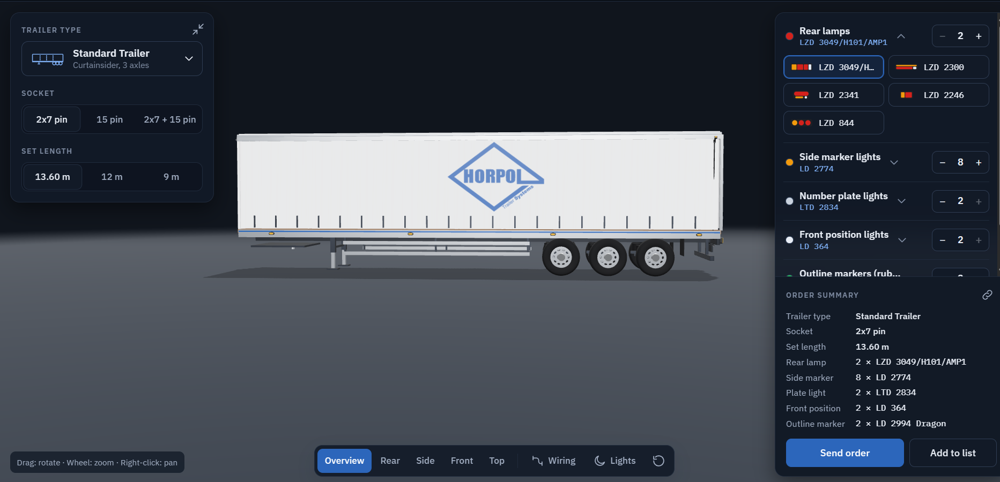

# Horpol Trailer Systems



Horpol dorse aydınlatma setleri için **kurumsal site** ve **3D konfigüratör**. Kullanıcı dorse tipini, soketi, set uzunluğunu ve lambaları seçer; seçimleri aynı anda 3D dorse üzerinde görür, sipariş özetini alır ve teklif ister.

> Durum: ilk sürüm geliştirme aşamasında. Sipariş gönderimi henüz bağlı değil (form doğrulanır, gönderilmez). Ayrıntı için "Eksikler" bölümüne bakın.

## Neler var?

**Kurumsal site (tek sayfa)**
- Hero, nasıl çalışır, ürün kataloğu (set, ara kablo, soket), "Set nedir?", alt bilgi
- 4 dil: Türkçe, English, Русский, العربية (Arapça sağdan sola)
- Açık ve koyu tema, mobil uyumlu
- Ürün arama, kategori filtresi, ürün detay penceresi
- Teklif listesi (sepet) ve teklif formu

**3D konfigüratör (`/tr/konfigurator/`)**
- 10 dorse tipi: standart (tenteli), kapalı kasa, frigorifik, düz platform, basamaklı, lowbed, damperli, tanker, araç taşıyıcı, konteyner şasi
- Soket (2x7, 15 pin, 2x7 + 15 pin) ve set uzunluğu (13,60 / 12 / 9 m) seçimi
- Stop, yan marker, plaka, ön pozisyon ve gabari lambaları (gerçek Horpol ürün kodlarıyla)
- Seçimler anında 3D modelde görünür; seçim yapınca kamera ilgili bölgeye gider
- Görünümler: genel, arka, yan, ön, üst; **tesisat** modu (renk kodlu kablo hatları); **ışıklar** (gece) modu
- Sipariş özeti, teklif listesine ekleme, paylaşılabilir bağlantı (yapılandırma adres satırında)
- Sol panel sade şeride küçültülebilir; kamera dorsenin tamamını boş alana sığdırır

## Teknoloji

| Alan | Seçim |
|---|---|
| Site | [Astro](https://astro.build) 7 (statik çıktı), TypeScript |
| Arayüz adaları | Preact 10 |
| 3D | [three.js](https://threejs.org) (paketli, CDN yok), istek üzerine çizim |
| Stil | Düz CSS + tasarım token'ları (`src/styles/`) |
| Yazı tipi | IBM Plex Sans / Arabic / Mono (kendi sunucumuzda) |

Performans ilkeleri: kurumsal sayfalar yaklaşık 15 KB JS ile açılır; 3D motoru (~163 KB gzip) yalnızca konfigüratör sayfasında ayrı bir parça olarak iner; sahne boştayken yeniden çizilmez.

## Çalıştırma

Gereksinim: Node.js 22.12 veya üzeri.

```bash
npm install
npm run dev      # http://localhost:4321/tr/
npm run build    # statik çıktı: dist/
npm run preview  # derlenmiş siteyi yerelde aç
```

## Proje yapısı

```
src/
  pages/[lang]/        ana sayfa ve konfigüratör sayfası (tr, en, ru, ar)
  components/          Astro bileşenleri; Preact adaları (Configurator, Catalog, HeaderTools)
  configurator/        konfigüratör verisi, metinleri, özet; engine/ altında 3D motor
  data/                ürün verisi (geçici)
  i18n/                arayüz metinleri (4 dil)
  lib/                 teklif listesi (sepet), yardımcılar
  config/site.ts       iletişim ve sosyal medya bilgileri (yer tutucu)
  styles/              global.css (tema) ve configurator.css
public/brand/          logo
docs/                  README görseli
```

## Eksikler (bilinenler)

- **Sipariş gönderimi yok:** form doğrulanır ama sunucuya gitmez; e-posta/kayıt altyapısı sırada.
- **3D lamba ve dorse modelleri temsilidir** (kodla çizilir); gerçek GLB modeller gelince değişecek.
- Ürün fotoğrafları, teknik değerler, iletişim ve sosyal medya adresleri **geçici/örnek**.
- Adet sınırları ve uzunluk kısıtları örnektir, satış ekibiyle doğrulanmalı.
- Rusça ve Arapça metinler yerli çevirmen onayı bekliyor.
- Konfigüratörün mobil düzeni ve Arapça görünümü kapsamlı test edilmedi.

## Katkı notları

- Yeni arayüz metni: `src/i18n/ui.ts` (site) veya `src/configurator/i18n.ts` (konfigüratör) içinde **4 dile birden** eklenir.
- Renkler yalnızca `src/styles/global.css` başındaki token'lardan alınır; Arapça için `left/right` yerine mantıksal CSS özellikleri kullanılır.
- Kaynak koda e-posta, anahtar veya sır yazılmaz.
