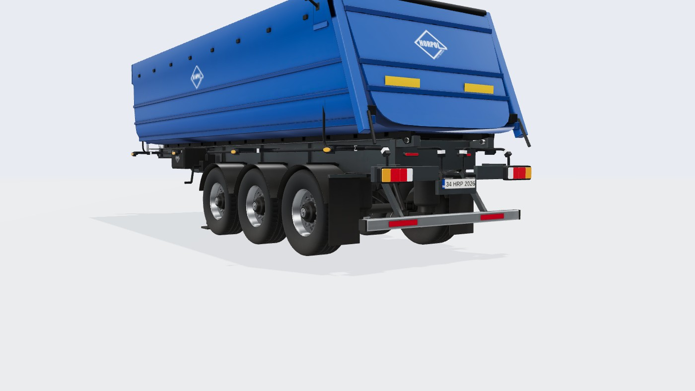
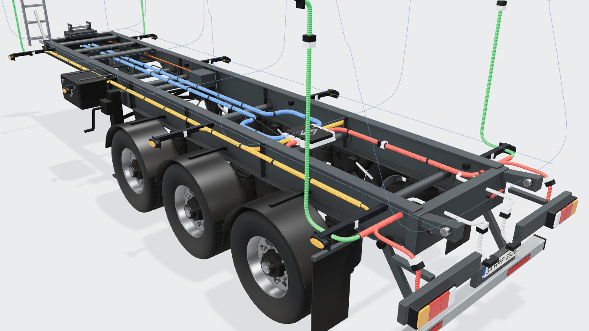
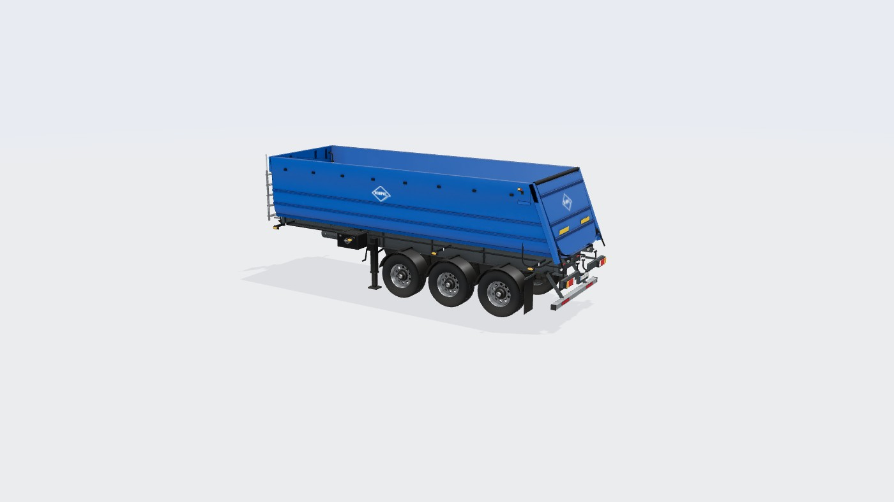
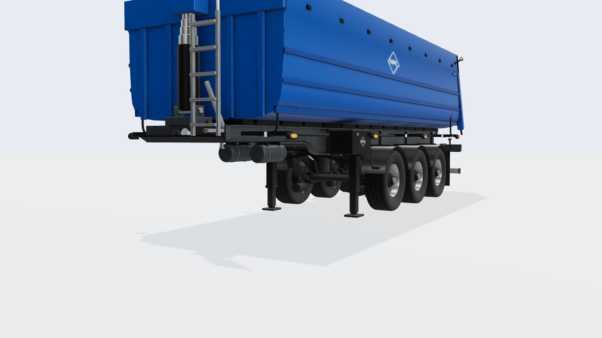
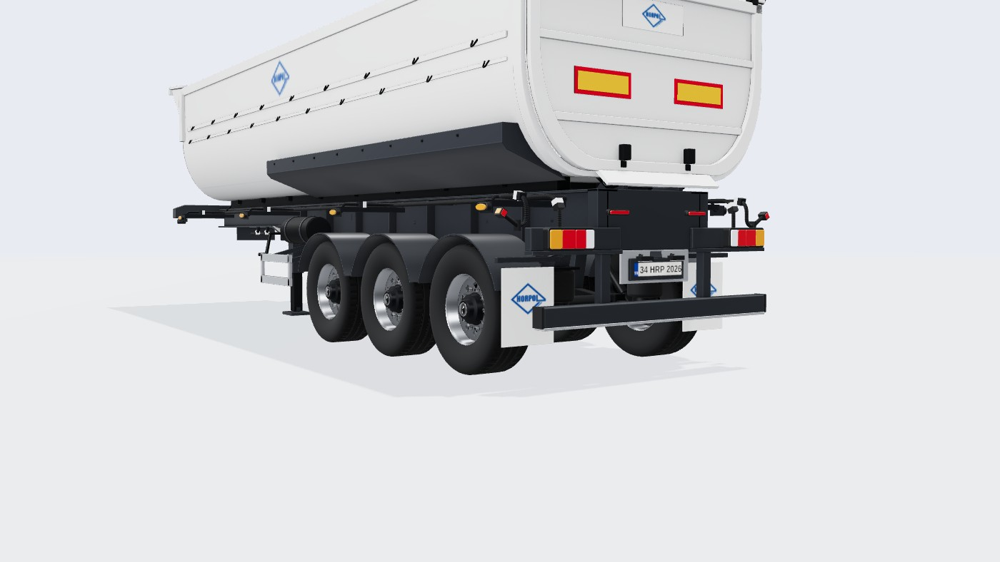
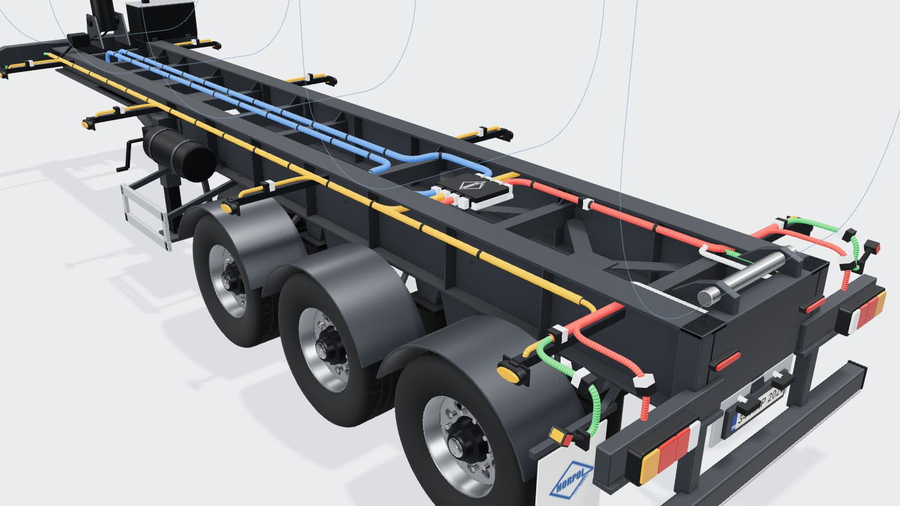

# Damper Dorse (devirmeli, U tabanlı Hardox kasa, 3 akslı)

Konfigüratördeki **damper** tipinin 3D modeli: referans, ölçüler, kararlar, üretim hattı ve ölçümler.
Model Blender betiğiyle üretilir; sayıların tek kaynağı [`tools/blender/damper.py`](../../tools/blender/damper.py).
Bu belge betikteki değerlerin özeti ve gerekçesidir; betik ile çelişirse betik geçerlidir.
Ortak hat ve yöntem standart dorseyle aynıdır: [Standart Dorse](../Standart%20Dorse/README.md).

Durum: 2026-10-18'de kodlandı. Önceki sürüm (`damper_chassis.py`, yarım boru beyaz kasa, `public/models/damper-*.glb`,
`engine/damper.ts`) kaldırıldı.




## 1. Referans

| Kaynak | Ne alındı |
|---|---|
| [Kässbohrer K.SKS B / 27-12/27 ürün sayfası](https://kaessbohrer.com/en/products/tipper-615-c/steel-628-c/ksks-b-27-12-27) | Teknik tablo, yapı tanımı |
| [Ürün broşürü (PDF)](https://www.kaessbohrer.com/uploads/static/media/product/709/attachments/auto_pdf/brochure_709_en.pdf) | Teknik tablo, **ölçekli yan/arka görünüş çizimi**, arka 3/4 fotoğraf |

Kässbohrer görselleri telifli olduğu için repoya kopyalanmadı. Üretici kırmızısı ve logosu kullanılmaz; yalnız Horpol logosu.

## 2. Teknik tablo (broşür)

| Ölçü | Değer |
|---|---|
| Hacim | 27 m³ |
| Dingil mesafesi (Wb) | 4.700 mm |
| Eyer yüksekliği H5 | 1.220 mm |
| Yükseklik (H) | 3.130 mm |
| Kasa boyu (A) | 8.300 mm |
| Kasa yüksekliği / iç yükseklik | 1.700 / 1.690 mm |
| Şasi | S700MC, iki kaynaklı I kiriş + traversler, KTL |
| Akslar | BPW AL II, havalı süspansiyon, kampanalı fren, 3 × 9 t |
| Kasa | Hardox 450 / TUF500, **U taban** |
| Hidrolik | HYVA 5 kademeli ön silindir |
| Seçenekler (modelde yok) | Katlanır tente, hidrolik arka kapak, tahıl kapağı, yedek lastik |

## 3. Çizimden ölçülenler

Ölçek **117,4 px/m** (dingil mesafesi 4,70 m ve yükseklik 3,13 m ile doğrulandı).

| Ne | Değer | Not |
|---|---|---|
| Toplam boy | 8,84 m | Ön merdiven dahil |
| King pin | arka uca 7,56 m | Orta aksa 4,70 m |
| Akslar | −4,17 / −2,86 / −1,55 m | Aralık ~1,31 m |
| İniş ayağı | −5,15 m | |
| Şasi üstü | 1,43 m | = kasa alt çerçevesi altı |
| Kiriş altı | önde 1,22 m (H5), king pinin ~1,1 m arkasından 1,02 m | Eğimli geçiş taralı alanda |
| Kasa | önü −8,0 m, üst 3,13 m, alt kuşak 2,74 m | Yanda yatay kırımlar 2,27 ve 1,93 m |
| Arka | eğik dikmeler: üstte −0,71, altta −0,06 m | Arka kapak üstten menteşeli, eğik |
| Alet kutusu | −6,0 … −5,36 m, 1,03–1,46 m | |
| Arka alt koruma | eğik kollarda, bar 0,44–0,56 m | Katlanır (pnömatik) |
| İz | lastik dış yüzü ~±1,10–1,14 m | Arka görünüş: dar iz |

## 4. Doğrulanmadı / varsayım

- Kasa kesitinin alt kavisi ("U taban") ve iç yüzler: arka görünüşteki dış çizgi ve kapak çevresinden yaklaşık.
- I kirişlerin yanal yeri (z ±0,58 m) ve kesiti; silindirin şasi ve kasa bağlantıları; arka devirme menteşesinin yeri.
- Ön merdiven şasiye bağlı kabul edildi (kasa devrilir).
- Yan markerlar şasiden uzanan braketlerde (sitede çizilir): devrilen kasaya bağlanmaz.
- Model tek boyda (8,84 m). Set uzunluğundan bağımsız.

## 5. Koordinatlar ve ana ölçüler (betikteki sabitler)

| Sabit | Değer | Anlam |
|---|---|---|
| `CH_X0` / `CH_TOP` | −8,29 / 1,43 | Şasi önü / üstü |
| `XN` / `XD` / `DEEP_BOT` | −6,45 / −6,0 / 1,02 | Kirişin derinleşmesi |
| `BZ` | 0,58 | I kiriş gövde ekseni |
| `WZ` | 0,95 | Tekerlek merkezi (dar iz) |
| `BX0` / `BTOP` / `RAIL_Y` | −8,0 / 3,13 / 2,74 | Kasa önü / üstü / üst kuşak altı |
| `RX_TOP` / `RX_BOT` | −0,71 / −0,06 | Eğik arka uç |
| `OUTER` / `INNER` | — | Kasa kesiti (dış / iç), U taban |
| `HY` | 1,32 | Tesisat (kiriş gövdesinden geçer) |

## 6. Model yapısı

**Şasi (`damper-chassis.glb`, tesisat görünümünde görünür; kasa devrildiğinde yerinde kalan her şey):** iki I kiriş
(gövde, üst başlık, eğriyi izleyen alt başlık, berkitmeler), boru traversler, ön travers, king pin plakası ve pimi, silindir
alt yatağı ve muylu, hidrolik rakor ve hortum, ön merdiven, iniş ayakları, alet kutusu (+z, logolu), iki hava tankı,
3 aks BPW havalı süspansiyon ve kampanalı fren, tekerlek başına kavisli çamurluk, paçalar, EBS, hava hatları ve fren hortumları,
arka kapanış traversi, devirme menteşesi kulakları ve pimleri, lamba taşıyıcıları, plaka tutucu, katlanır alt koruma
(eğik kollar, alüminyum bar, reflektörler).

**Kasa (`damper-body.glb`, tesisat görünümünde gizlenir):** tek parça U kabuk (dış ve iç yüz ayrı malzeme), ön duvar ve
dikmeleri, ön üst bant, silindir üst yatağı, HYVA 5 kademeli silindir (kapalı; dış gövde siyah, kademeler krom),
yatay kırımlar ve alt kenar profili, tente kancaları, kasa alt çerçevesi (boylamalar, traversler, menteşe kulakları),
eğik arka dikmeler ve köşe levhaları, üst menteşe borusu, eğik arka kapak (takviyeler, sarı reflektörler), kilit ve kolları,
yanlarda ve arka kapakta beyaz logo.

## 7. Renk düzeni ve dokular

| Parça | Renk / malzeme |
|---|---|
| Kasa | Horpol mavisi (logo rengi `#1c5198`), saten; kenarlarda aşınma |
| Kasa içi | Aynı mavi, yoğun toz ve aşınma (yük teması) |
| Şasi | Antrasit KTL |
| Süspansiyon, çamurluk, paça | Siyah |
| Silindir | Siyah gövde, krom kademeler |
| Alt koruma | Alüminyum, kırmızı reflektör |
| Jantlar | Cilalı alüminyum |

Öneri, tasarım kararı (onay bekliyor): kasa rengi marka mavisi; diğer tiplerle (beyaz standart ve tanker, antrasit
lowbed, alüminyum silobas) ayrışır.

## 8. Bağlantı noktaları

[`damper-anchors.json`](../../src/configurator/engine/damper-anchors.json):

| Ne | Yer |
|---|---|
| Stop lambaları | Lamba taşıyıcı levhaları, x = 0; y 1,03; z ±0,95 ve ±0,42 |
| Plaka | y 0,92, tutucuda |
| Yan markerlar | Şasiden uzanan braketlerde, y 1,30 (`brackets: true`) |
| Ön pozisyon | Kasa ön duvarının üst köşeleri (y 2,95) |
| Gabari | Kasanın üst ön ve arka köşeleri (y 2,92) |
| Ek lambalar | Arka kapanış traversi yüzü, y 1,25 |
| Soketler | Ön travers, y 1,32 |
| Tesisat | y 1,32 kiriş gövdesinden; yan ana hat z ±0,70, arka hatlar z ±0,40 |

## 9. Üretim hattı

```bash
blender -b -P tools/blender/damper.py          # tam kalite ~8 dk; --fast ~2 dk; --anchors yalnız JSON
npm run models:pack -- damper
```

## 10. Ölçümler

| Ölçüm | Değer |
|---|---|
| Model indirme | 1,90 MB (gzip 1,49 MB) |
| Üçgen | şasi 49,4 bin, tekerlek 17,7 bin (× 6), kasa 9,6 bin |

## 11. Sonraki işler (öneri)

- Devirme animasyonu (kasa menteşe pimi etrafında döner, silindir kademeleri açılır) eklenebilir; kasa ayrı GLB olduğu için
  hazır.
- Katlanır tente ve yedek lastik seçenekleri.

## 12. Görseller

| | |
|---|---|
| Genel  | Arka 3/4  |
| Ön 3/4  | Tesisat, arka  |
| Önceki (yarım boru)  | Önceki, tesisat  |

## 13. Lamba montaj haritası (R48)

Kaynak: `damper.py` → `mounts_dict()` → `damper-anchors.json` içindeki `mounts`. Kontrol: `node tools/check-lighting.mjs`.
Kasa ve kapak devrilir: her lamba, kol ve braket **yalnız şasiye** bağlanır.

| Montaj | Yer (x, y, z) | Parça | Gerekçe |
|---|---|---|---|
| Arka lambalar | yüz x 0; y 1,00; z 1,20 → 0,30 | Lamba levhası (y 0,96–1,12) | M8 saplamalar levhada, gövde 34 mm aşağı taşar: LZD 3194 sis kanalının üst kenarı 0,99 (≤ 1,0). Sisi üst yarıda olan bir ürün seçilirse ayrı sis lambası gerekir |
| Plaka + lambası | plaka y 0,865 (tutucu 0,80–0,96 içinde); lambalar y 0,945, z ±0,17 | Plaka tutucu | Eski plateY 0,92 tutucunun üstünden taşıyordu |
| Yan marker | x −6,19 … −0,95; y 1,25; z 1,27; yan başına en çok 5 | Kirişten L braket (her marker) | Alet kutusu (+z) ve iniş ayağı `side.avoid`. Çamurluk tepesi 1,13, kasa altı 1,43 (R48 6.18 ≤ 1,5). En az 3 |
| Ön pozisyon | x −8,265; y 1,33; z 1,17 | Ön traversten dışa braket (z 0,64 → 1,19) | Eski yer devrilen kasanın üst köşesindeydi (y 2,95) |
| Lastik kol ön | x −8,21; y 1,33; duvar z 1,19 | Aynı ön braket | Şasinin önündeki en yüksek sabit yer |
| Lastik kol arka | x −0,03; y 1,04; duvar z 1,20 | Lamba levhasının dış ucu | Horpol şeması; şasinin arkadaki en yüksek sabit noktası |
| Çalışma (2) | x −0,10; y 1,20; z ±0,83; yön (1, −0,35, 0) | Lamba kollarının üstü (braket) | Devrilen kasanın altında kalır; kasa arka ucu devrilirken ~1,37 m'nin altına inmez |
| Tepe (1) | x −8,60; y 3,10; z 0,78 | Ön merdiven direğinin tepesi | Şasiye bağlı tek yüksek yer; kasa üstünü 9 cm aşar. İkinci yer yok |
| Tesisat | y 1,32 (I kiriş gövdesinin iç yanı, z 0,55), arkada menteşe kulaklarının altına 1,25; modül x −1,3; arka dağıtım x −0,25 | Kiriş gövdesi | |

## Revize (2026-10-20, kullanıcı isteği)

Önceki montaj tablosunu geçersiz kılan değişiklikler (sayılar `tools/blender/damper.py`):
- **Yan markerlar:** kirişten uzanan L braketler kaldırıldı. Markerlar kasanın alt kenar profilinin ('side_bottom') dış yüzünde (y 1,61, z 1,151), x −6,19 … −0,95, en çok 5/yan. Kasa devrilir: markerlar kasayla birlikte döner. R48 6.18 üst sınırı 1,5 m aşılır: **kural dışı, kullanıcı kararı**.
- **Yan hat kablosu:** arka lambadan levhanın arkasından menteşe hizasına (x −0,20, z 0,83) gelir, lamba kolu ve çalışma lambasının önünden kasa altına çıkar, kasa tabanının altını izleyip alt kenar profilinin içinde tek düz hat olarak öne gider. Şasiden kasaya yalnız menteşe yanında geçer (devrilmede kopmaz). Ön pozisyon ve ön kol şasi demetinden (modülün yedek portu, kiriş içi) beslenir.
- **Plaka:** plaka tutucu lamba levhasının hemen altında, arka yüzü levhayla aynı düzlemde (x −0,06…0, y 0,78–0,96, z ±0,36): ikisi tek parça. Plaka merkezi y 0,87.
- **Stop lambaları:** levhanın ortasında y 1,04 (eskiden 1,00, gövde levhanın altından taşıyordu). LZD 3194 sis kanalı üstü ~1,03 m (R48 ≤ 1,0): bilinçli.
- **Tepe lambaları (2):** çalışma lambalarının dış yanında, lamba kolu ile levha arasındaki yeni rafta (x −0,12, y 1,14, z ±1,03). Merdivendeki tek tepe lambası ve direği kaldırıldı.
- **Arka kablolar:** arka dağıtım arka traversin önünde (x −0,50). 7×1 hatlar z ±0,40'ta lamba yüksekliğine iner ve levhanın arkasından lambalara gider; çalışma/tepe kabloları kirişin altından (y 1,05) levhanın arkasından gelir. Arkadan bakınca travers ve levha kabloları örter.
- **Tesisat çerçevesi:** `outline()` sol üst köşeyi atlıyordu (üstte eğik çizgi, ön duvarda kesik köşe); düzeltildi. Ara kesitler üstü açık çizilir.
- **Ön merdiven:** iki ayak da 2,94 m'ye uzanır ve üstte tutamakla birleşir.
- **Arka kapak:** kabuğun arka ağzı (dış ve iç yüz arası) kapatıldı; kapak iç çevreden dışa taşacak kadar büyütüldü ve sol üst köşesindeki kesik (aynı `[1:-1]` hatası) giderildi.

## Arka tampon (2026-10-22)

Lamba levhaları ve plaka tutucusu yerine Horpol sac tamponu (`tools/blender/bumpers.py`; türev stop lambasından), arka yüzü x 0, web ortası 1,04 (plaka da tamponda, 1,04). Arka traversten gelen kollar tamponun üstünde (y 1,205–1,225) raf olur: çalışma ve tepe lambaları burada; tampon kollara askı lamalarıyla bağlı. Tozluk katlanır alt koruma demirinin alt kenarına kenetli (TRAILER SYSTEMS), reflektörler demirin üst yarısında. Arka lastik kol tamponun uç sacında.
