# Lowbed Dorse (sabit, 3 akslı alçak yükleyici)

Konfigüratördeki **lowbed** tipinin 3D modeli: referans, ölçüler, kararlar, üretim hattı ve ölçümler.
Model Blender betiğiyle üretilir; sayıların tek kaynağı [`tools/blender/lowbed.py`](../../tools/blender/lowbed.py).
Bu belge betikteki değerlerin özeti ve gerekçesidir; betik ile çelişirse betik geçerlidir.
Ortak hat ve yöntem standart dorseyle aynıdır: [Standart Dorse](../Standart%20Dorse/README.md).

Durum: 2026-10-18'de kodlandı.

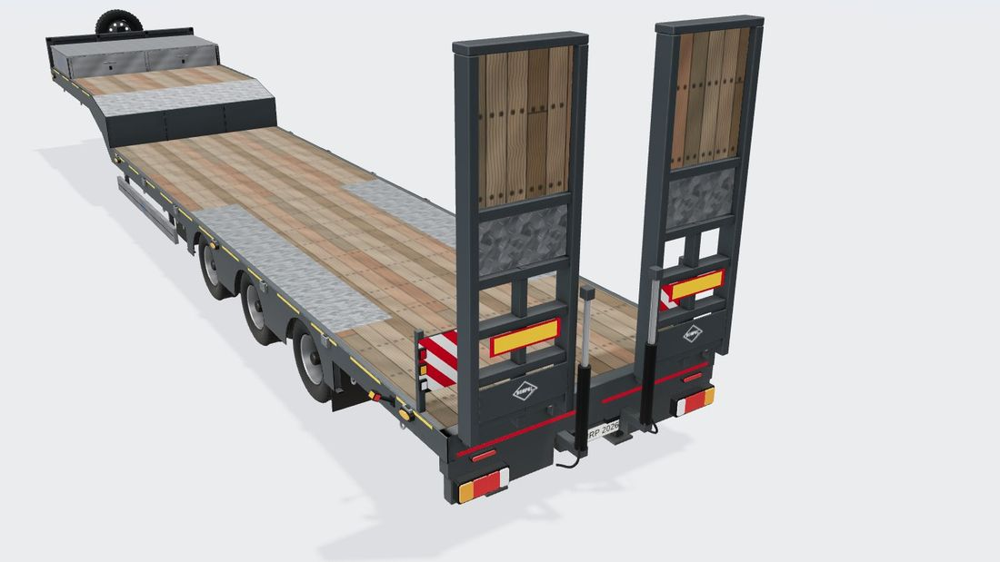
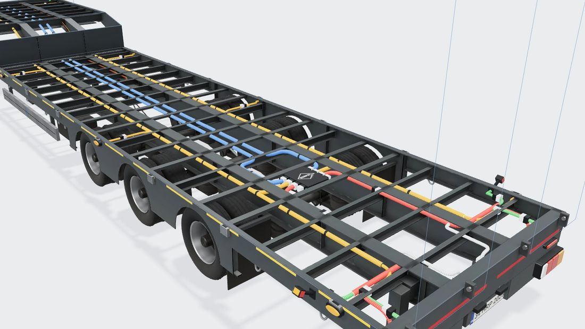

## 1. Referans

| Kaynak | Ne alındı |
|---|---|
| [Kässbohrer K.SLS 3 / 0N-18/30 ürün sayfası](https://kaessbohrer.com/en/products/low-bed-588-c/fixed-591-c/ksls-3-0n-18-30) | Teknik tablo, yapı tanımı |
| [Ürün broşürü (PDF, 2 sayfa)](https://www.kaessbohrer.com/uploads/static/media/product/629/attachments/auto_pdf/brochure_629_en.pdf) | Teknik tablo, **ölçekli yan/arka görünüş çizimi**, arka 3/4 fotoğraf, bağlama ve rampa seçenekleri |

Kässbohrer görselleri telifli olduğu için repoya kopyalanmadı. Üretici kırmızısı ve logosu kullanılmaz; yalnız Horpol logosu.

## 2. Teknik tablo (broşür)

| Ölçü | Değer |
|---|---|
| Toplam boy (L) | 13.190 mm |
| Boyun boyu (GL) | 3.950 mm |
| Platform boyu (PL) | 9.240 mm |
| Genişlik | 2.550 mm (+ 2 × 300 mm genişletme, seçenek) |
| Platform yüksekliği (PH) | 875 mm |
| Eyer yüksekliği H5 | 1.250 mm |
| Dingil mesafesi (king pin → orta aks) | 8.100 mm |
| Akslar | 3 sabit BPW, kampanalı fren, havalı süspansiyon |
| Lastik | 245/70 R17,5 (Ø 787,5 mm → R = 0,394 m) |
| Şasi | S700MC, ISO 1726 |
| Taban | 45 mm sert ağaç; **yalnız tekerleklerin üstünde** damla desenli çelik sac |
| Rampa | Arkada taşınabilir alüminyum rampa hazırlığı (fotoğrafta dik duran iki rampa) |
| Bağlama | Boyunda, platformda ve yan kirişlerde bağlama halkaları; kazık cepleri; 20' konteyner kilitleri |

## 3. Çizimden ve fotoğraftan ölçülenler

Yan görünüş çizimi piksel ölçümüyle okundu. Ölçek **76,95 px/m**; boyun/platform oranı (3,95 / 9,24) ve dingil mesafesi
(orta aks king pinden tam 8,10 m geride) ile doğrulandı. Bu çizimde tablo ile çelişki yok.

| Ne | Değer | Not |
|---|---|---|
| King pin | ön uca 1,31 m | Ön dönme yarıçapı |
| Aks aralığı | 1,36 m | Akslar arka uca göre −5,14 / −3,78 / −2,42 m |
| Boyun üstü | 1,507 m | Arkada pahla 1,33 m'ye iner, sonra dikey arka duvar |
| Boyun altı | 1,25–1,265 m | King pin plakası; ön uca 2,9 m'den sonra eğimle iniş ayağına iner |
| İniş ayağı | ön uca 3,74 m | Kaz boynunun eğimli kısmında |
| Başlık (ön duvar) | 2,0 m'ye kadar | Önüne dik bağlı yedek lastik (merkez 1,975 m, boyun önünden taşar) |
| Saklama kutusu | boyun önünde 1,48 m, 1,87 m'ye kadar | Alüminyum, tüm genişlik |
| Yan koruma | 0,26–0,46 m | Geniş alüminyum profil, iniş ayağından ön aksa |
| Rampalar | üstü 3,46 m, genişlik 0,86 m, z ≈ ±0,78 m | Dik duruyor; üstte ahşap, ortada damla sac, altta açık çerçeve |
| Arka destek ayakları | arka uçta, yere değiyor | Rampayla yükleme için |
| Tekerlek | yan başına **çift** | Fotoğrafta derin çanaklı jantlar; yük hesabı da gerektiriyor (10 t aks / 245 lastik) |
| Yan kiriş | tekerlek üstünde kemerli etek | Akslar arasında göbek hizasına iner (fotoğraf) |

## 4. Doğrulanmadı / varsayım

- Şasi altı fotoğrafı yok. Ana kiriş aralığı (±0,45 m), kiriş derinliği (0,50–0,83 m), traverslerin aralığı (0,5 m) ve
  tekerlek üstünde ince sac traversler, tekerlek ölçüsü ve platform yüksekliğinden çıkarım (lastik üstü 0,787 m, taban 0,875 m:
  aradaki 8,8 cm'ye kalas + ince travers sığar).
- Alçak süspansiyon (körük 0,36–0,49 m, salıncak pivotu 0,27 m) ve kampanalı fren geometrisi genel BPW yapısına göre.
- Arka lamba yüksekliği (0,45 m) ve plaka (0,47 m) arka görünüş çizimi ve fotoğraftan yaklaşık.
- Model tek boyda (13,19 m). 13,6 ve 12 m setlerde aynı dorse görünür.

## 5. Koordinatlar ve ana ölçüler (betikteki sabitler)

three.js düzeni: **x boyuna** (arka uç 0, ön −13,19), **y yukarı**, **z yanal**.

| Sabit | Değer | Anlam |
|---|---|---|
| `DECK` | 0,875 | Platform tabanı üstü |
| `FR_TOP` | 0,830 | Platform şasi üstü (45 mm kalas altı) |
| `NECK_TOP` | 1,507 | Boyun tabanı üstü |
| `H5` | 1,250 | King pin plakası altı |
| `XG` | −9,24 | Boyun arka duvarı = platform önü |
| `BZ` | 0,45 | Ana kiriş gövde ekseni |
| `BEAM_BOT` | 0,50 | Platform ana kiriş altı |
| `WZ` / `TWIN` | 0,97 / 0,28 | Çift tekerlek göbeği / iki lastik arası |
| `KING_X` | −11,88 | King pin |
| `LEG_X` | −9,45 | İniş ayağı |
| `HARNESS_Y` / `NECK_H` | 0,80 / 1,40 | Tesisat: platformda / boyunda |

## 6. Model yapısı

**Şasi (`lowbed-chassis.glb`, tesisat görünümünde görünür):** boyundan platforma tek parça kaz boynu ana kirişleri
(üst başlık boyunda, pahta ve platformda; alt başlık eğri boyunca), king pin plakası ve 2" pim, boyun ön kirişi ve
C traversleri, boyun arka duvarı, boyundan platforma tek levha dış yan kirişler (tekerlek üstünde kemerli etek,
etek takviyeleri), platform traversleri (tekerlek üstünde 3 cm sac), arka travers ve rampa menteşe kulakları, lamba ve plaka
tutucuları, arka destek ayakları, iniş ayakları (dişli kutusu ve kol +z), 3 aks alçak havalı süspansiyon (askı, salıncak
kolu, U cıvata, alçak körük, amortisör), kampanalı fren (kampana, fren körüğü, gergi kolu), paçalar, alüminyum yan koruma
(logolu), alet kutusu (+z), iki hava tankı, EBS, kırmızı/sarı hava hatları (kaz boynu eğrisini izler), fren hortumları,
kazık cepleri, bağlama halkaları. Sarı kesikli kontur bandı ve arka kırmızı bant ayrı, AO'suz bir nesnede.
Çift tekerlek tek model, 6 örnek.

**Üst yapı (`lowbed-body.glb`, tesisat görünümünde gizlenir):** başlık (dikmeler, panel, takviyeler), yedek lastik ve
bağlantısı, saklama kutusu (alüminyum, iki kapak, kulplar, iki yanda logo), iki rampa (raylar, uç sacı, çerçeve, hidrolik
silindir ve hortumu, R70 plakası, logo), arka köşelerde kırmızı-beyaz uyarı levhaları ve 3'lü lamba grubu;
ayrıca dokulu taban nesnesi.

**Tesisat görünümünde** gövdenin yerini platform ve boyun taban çerçeveleri, pah, başlık, kutu ve iki rampa konturu gösterir.

## 7. Renk düzeni ve dokular

İlk sürüm her yeri aynı parlak beyazdı ve oyuncak gibi duruyordu (2026-10-18 kullanıcı geri bildirimi). Nedenleri:
tek malzeme, yüzeyde hiç değişim olmaması, AO'nun sitede yalnız dolaylı ışığı etkilemesi (güneş alan yüzeyler kusursuz düz kalıyordu).

**Renk düzeni:**

| Parça | Renk / malzeme |
|---|---|
| Gövde, boyun, rampa çerçeveleri, başlık | Antrasit RAL 7016 (`#373d41`), saten boya + vernik |
| Süspansiyon, akslar, iniş ayakları | Siyah (`#1e2023`) |
| Kazık cepleri, halkalar, kelepçeler | Sıcak daldırma galvaniz |
| Saklama kutusu yanları, yan koruma | Fırçalanmış alüminyum (saten) |
| Tekerlek üstü, boyun pahı, kutu kapağı, rampa ortası | Galvaniz damla desenli sac |
| Taban, rampa dolguları | Apitong benzeri sert ağaç |
| Jantlar | Gümüş (RAL 9006 benzeri), göbek koyu |
| Vurgular | Sarı kesikli kontur bandı, kırmızı-beyaz uyarı levhaları, kırmızı arka bant; koyu yüzeyde beyaz logo |

Tesisat görünümünde antrasit şasi üzerinde renkli hatlar okunaklıdır (standart dorseyle aynı ilke).

**Pişirilmiş yüzey dokuları** (`bl_common.bake_surface`): AO'ya ek olarak şasi, tekerlek, üst yapı ve yedek lastik için
renk (albedo) ve ORM (R = AO, G = pürüzlülük, B = metallik) dokusu Cycles'ta pişirilir:
- **Yol tozu:** çukurlarda (AO'dan) ve yere yakın yüzeylerde (yükseklikten), gürültüyle düzensiz; malzeme başına oranı ayrı
  (süspansiyonda yoğun, kromda çok az).
- **Kenar aşınması:** Bevel düğümüyle bulunan dışbükey kenarlarda, seyrek; yalnız boyalı yüzeylerde, boya altından çelik.
- **Pürüzlülük:** tozlu yerlerde artar, yüzey boyunca hafif değişir; metallik tozda azalır.
Bunlar sitede güneş ışığında da görünür. Malzemeler glTF'e renk dokusu + ORM ile bağlanır (three.js tek GPU yüklemesiyle paylaşır).

**Tekrarlanan dokular** (numpy ile üretilir, dikişsiz, GLB'ye gömülür; AO atlası dışında, düzlemsel UV):
- **Sert ağaç** (4,0 × 0,9 m karo, 1536 × 576): 0,15 m'lik 6 kalas, kalas başına farklı yıpranma (kızıl kahveden
  griye), damar ve lif çizgileri, lekeler, kirli derzler, uç birleşimleri, **platform traverslerine hizalı cıvata sıraları**;
  renk + normal + ORM.
- **Galvaniz damla sac** (0,3 m karo, 512²): kristal (çiçeklenme) deseni, trafikten parlamış damlalar, kirli aralar;
  renk + normal + ORM.
- **Fırçalanmış alüminyum** (0,5 m karo, 512²): çizgiler ve seyrek çizikler; renk + ORM.

Çözünürlükler: şasi renk + ORM 2048², üst yapı 1024², çift tekerlek 1024², yedek 512².

## 8. Bağlantı noktaları

[`lowbed-anchors.json`](../../src/configurator/engine/lowbed-anchors.json) (şema: [`baked.ts`](../../src/configurator/engine/baked.ts)):

| Ne | Yer |
|---|---|
| Stop lambaları | Alçak lamba tutucuları, x = 0; y 0,45; z ±1,02 ve ±0,58 |
| Plaka | y 0,47, tutucuda; plaka lambaları üst kenarda |
| Yan markerlar | Yan kirişte; boyunda y 1,39, kaz boynunda eğimli, platformda y 0,82 (kemer üstü şerit) |
| Ön pozisyon | Başlığın üst köşeleri, y 1,92 |
| Gabari | Önde boyun yanı (y 1,39), arkada platform yanı (y 0,80) |
| Ek lambalar | Arka travers yüzü, y 0,66 |
| Soketler | Boyun ön kirişi, y 1,39 |
| Tesisat | Boyunda y 1,40, kaz boynu kiriş eğrisini 0,1 m üstten izler, platformda y 0,80; yan ana hat z ±0,60 (tekerleklerin içinde), arka hatlar z ±0,38 |

## 9. Üretim hattı

```bash
blender -b -P tools/blender/lowbed.py          # tam kalite ~3 dk; --fast ~30 sn; --anchors yalnız JSON
npm run models:pack -- lowbed
```

## 10. Ölçümler

| Ölçüm | Değer |
|---|---|
| Model indirme | 1,98 MB (gzip 1,50 MB); renk ve ORM dokularıyla. Önceki beyaz sürüm 1,41 MB (gzip 0,91 MB) |
| Üçgen | şasi 48,6 bin, çift tekerlek 18,4 bin (× 6), üst yapı 8,1 bin, yedek 10,6 bin |

## 11. Görseller

| | |
|---|---|
| Genel 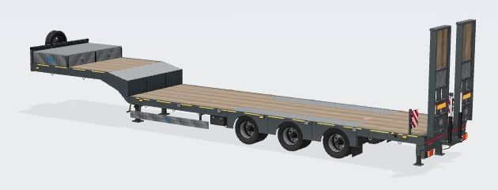 | Yan 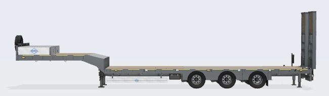 |
| Ön alt açı 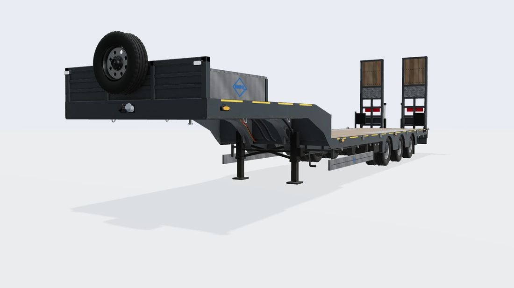 | Boyun ve pah 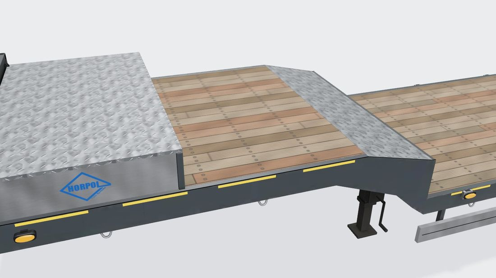 |
| Şasi yakın 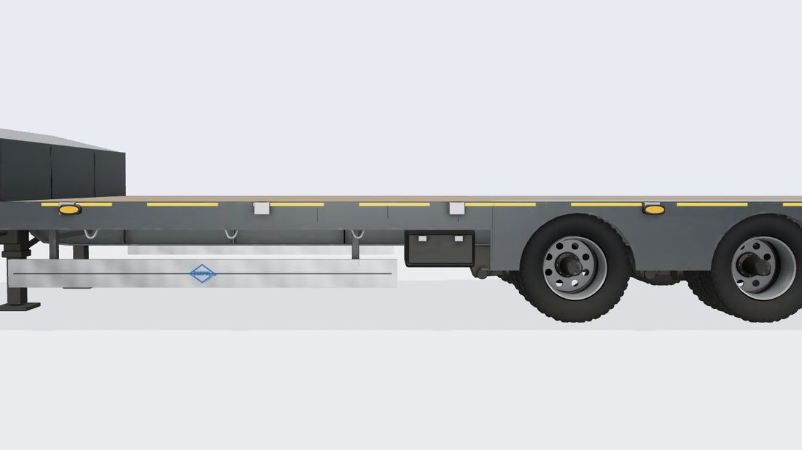 | Arka alt açı 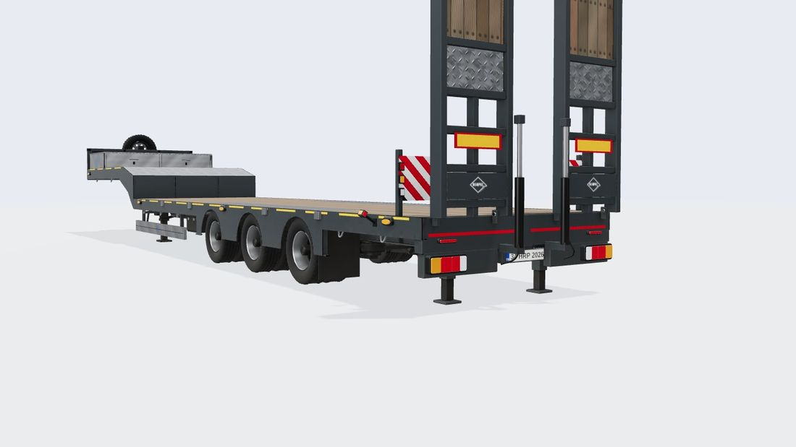 |
| Tesisat, ön 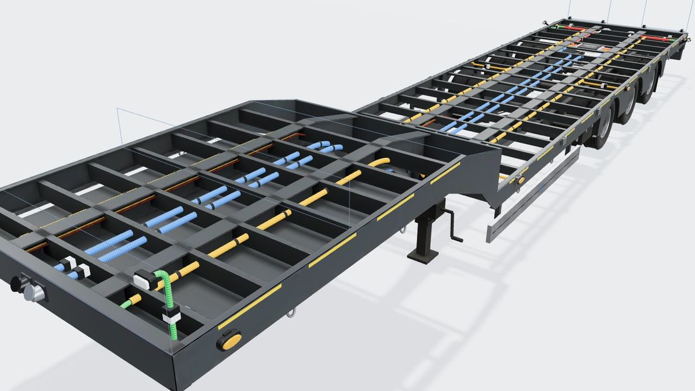 | Tesisat, orta 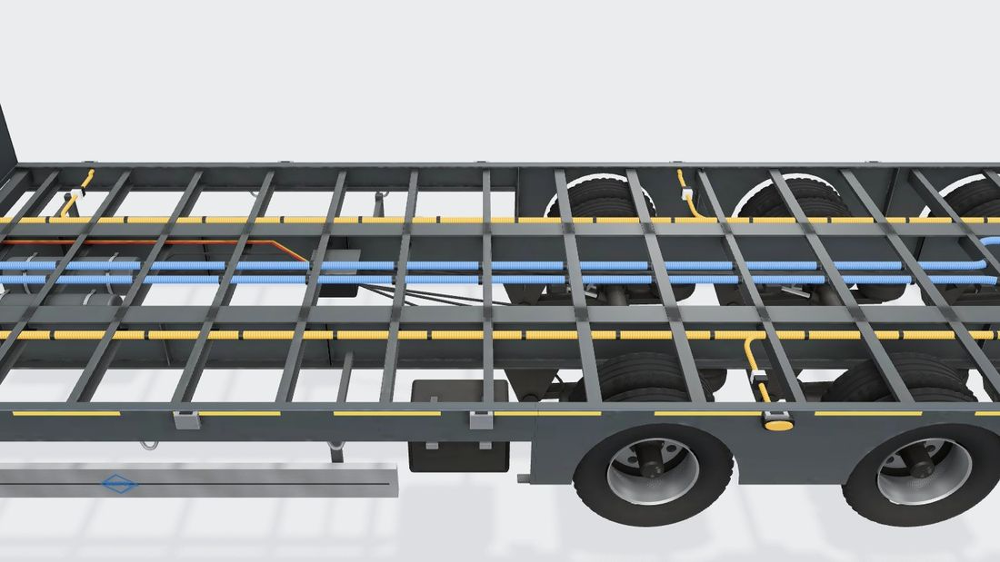 |
| İlk Blender sürümü (beyaz) 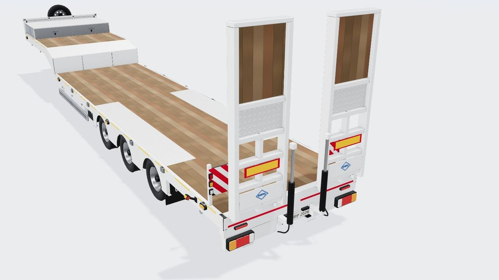 | Önceki (kodla çizilen) 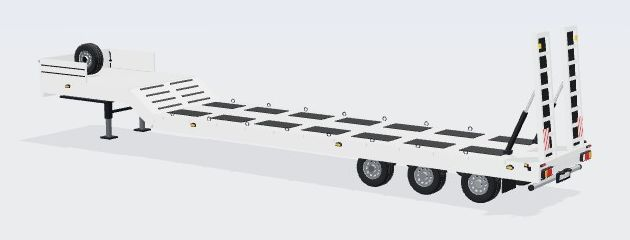 |
| Önceki, tesisat 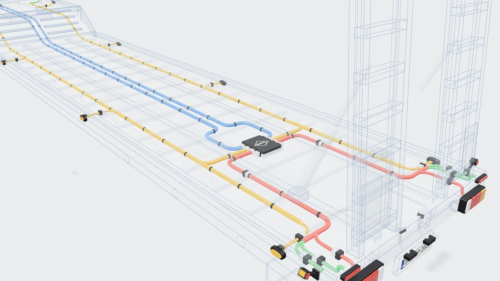 | |

## 12. Sonraki işler (öneri)

- 4 akslı ve uzayan (extendable) varyantlar ayrı betik sabitleriyle üretilebilir.
- Rampa güvenlik zinciri / gaz yayı, konteyner kilitleri, kazıklar eklenmedi.

## 13. Lamba montaj haritası (R48)

Kaynak: `lowbed.py` → `mounts_dict()` → `lowbed-anchors.json` içindeki `mounts`. Kontrol: `node tools/check-lighting.mjs`.
Rampalar hareketli, lamba yeri değil. Başlık ve arka uyarı direkleri kaynaklı sabit parçalar (GLB'de "body").

| Montaj | Yer (x, y, z) | Parça | Gerekçe |
|---|---|---|---|
| Arka lambalar | yüz x 0; y 0,45; z 1,25 → 0,36 | Alçak lamba tutucuları | Dış kenara 0,025 m; alt kenar 0,376 (≥ 0,35) |
| Plaka + lambası | plaka y 0,47; lambalar y 0,545, z ±0,17 | Plaka tutucu | |
| Yan marker | x −11,0 … −0,6; z 1,276; yan başına en çok 9 | Dış yan kiriş levhası | Boyunda y 1,39 (altında yapı yok; R48 6.18 ≤ 1,5), kaz boynunda levha ortası, platformda 0,74 (kazık ceplerinin altı), tekerlek kemerlerinin üstünde 0,835. Eşit dağıtımda yan başına en az 5 |
| Ön pozisyon | x −13,19; y 1,85; z 1,215 | Başlık köşe dikmesi | Dış kenara 5 mm |
| Lastik kol ön | x −13,15; y 1,88; duvar z 1,275 | Başlık köşe dikmesi yan yüzü | Önde en yüksek sabit nokta |
| Lastik kol arka | x −0,40; y 1,44; duvar z 1,265 | Arka uyarı direği yan yüzü | Platform üstünde en yüksek sabit yer. Alternatif: lamba tutucunun ucu y 0,45 (`armRearAlt`) |
| Çalışma (2) | x −0,38; y 1,56; z ±1,18; yön (1, −0,4, 0) | Uyarı direklerinin üstü (braket) | Rampalara ve arka yükleme alanına bakar |
| Tepe (2) | x −13,15; y 2,0; z ±1,0 | Başlık üst kuşağı + adaptör levhası | Dik duran rampalar arkadan görünürlüğü keser (yüklemede iner) |
| Tesisat | boyun 1,40 → platform 0,80; yan hat z 0,415; modül x −1,3; arka dağıtım x −0,16 | Traverslerin gövdesi | |

## Revize (2026-10-20, kullanıcı isteği)

Önceki "Lamba montaj haritası" tablosunu ve uyarı levhası anlatımını geçersiz kılan değişiklikler (sayılar `tools/blender/lowbed.py`):
- **Arka köşe uyarı levhaları (direk, kırmızı-beyaz şeritli levha, 3'lü lamba) modelden kaldırıldı;** model yeniden üretildi (paketli toplam 1,98 → 1,89 MB).
- **Lastik kollar:** kasanın 4 ALT köşesi: arkada platform yan kirişinin alt köşesi (x −0,06; y 0,756), önde boyun yan kirişinin alt köşesi (y NECK_BOT + 0,10). 2 adette arka, 4 adette ön de.
- **Ön pozisyon:** başlığın ön ÜST köşeleri, öne bakar (y 1,92).
- **Çalışma lambaları:** arka travers yüzünde, plaka ile kırmızı kontur bandı (y 0,70) arasında (y 0,565; z ±0,62), arkaya bakar.
- **Tepe lambası kabloları:** ön paneli delmez; başlığın arkasından köşe dikmesini izleyerek lambaya çıkar (önden görünmez).

## Revize (2026-10-22, kullanıcı isteği)

Önceki revizeyi ve montaj tablosunu geçersiz kılan değişiklikler (sayılar `tools/blender/lowbed.py`):
- **Kurallar standart dorseyle aynı** (`src/configurator/data.ts` TRAILER_RULES): RTR 3366 plaka çerçevesi sabit (LTD 2834 / LTD 669 isteğe bağlı ek), ön pozisyon yan markerın eşi, lastik kol yalnız arka çift (LZD 3194 → LDCC 2698). Fark: tepe lambası seçilebilir.
- **Çalışma lambaları:** lamba tutucusunda stop ile plaka arasında (`between`; site seçime göre z hesaplar), y 0,45, düz arkaya.
- **Rampa silindirlerinin hortumları kaldırıldı** (çalışma lambalarının önüne sarkıyordu). **Kırmızı / sarı hava hatları kaldırıldı** (standart dorsedeki gibi).
- **Lastik kollar:** standart kuralı: stop lambasının kol yuvası (LZD 3194, LZD 2854) yoksa lamba tutucusunun iki ucu (`armRearAlt`). Ön kollar kalktı.
- **Yan markerlar iki düz seviyede:** boyunda y 1,39 (x −12,39 … −10,365), platformda y 0,74 (x −9,18 … −0,6); iki kesim (`segments`) ayrı ayrı eşit aralıklı, adet kesimlere boylarıyla orantılı. Kaz boynunda (boyun altının kırıldığı yerden arka duvarın arkasına) marker yok. Platformda tekerlek kemerine (aks ± 0,47) düşen marker en yakın kenara kayar (`avoid`). Tavan 20 (yan başına 10).
- **Ön pozisyon:** boynun ön ALT köşeleri (x −13,19; y 1,303), öne bakar.
- **Tepe lambaları:** başlığın üst köşelerinde kaynaklı taban sacı (x −13,15; y 2,01; z ±1,195). Alçak yükleyicilerde yaygın yer; rampalar hareketli olduğu için arkada sabit yüksek yer yok. Kablo modülün ön yüzündeki Superseal'den öne, başlığın arkasından yükselir.
- **Tesisat yeni şemada** (standart dorseyle aynı): `harness.top.profile` ile tesisat görünümünde hatlar boyun, pah ve platform boyunca şasinin üstünden gider. Modül x −1,05 (−1,0 traversinin üstü), yan hat dönüşü x −0,305.
- **Arka tampon (2026-10-22):** alçak lamba ve plaka tutucuları yerine Horpol sac tamponu (türev stop lambasından; bkz. Standart Dorse README). Arka travers lamba yüksekliğinde olduğundan tampon traversin arkasında (arka yüz x 0,09), üst dudağı traversin yüzüne askı lamalarıyla cıvatalı. Rampa silindirlerinin alt kulakları tamponun üstüne (y 0,62–0,70) alındı. Tozluk tamponun alt dudağına asılı (alt koruma demiri yok), alt kenarı yerden 0,10 m.
- **Plaka:** RTR 3366 zorunluluğu kalktı; üç plaka aydınlatması tek tek seçilir.
