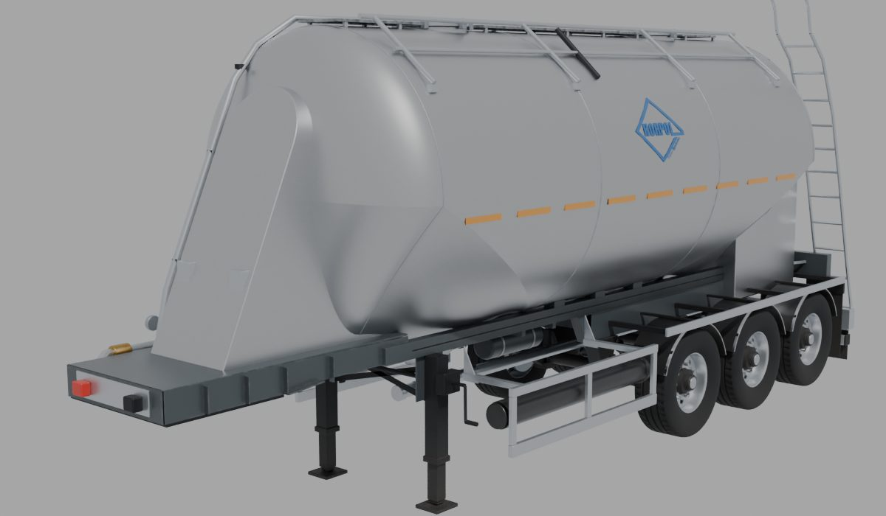
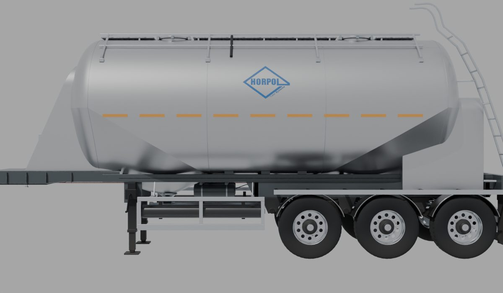
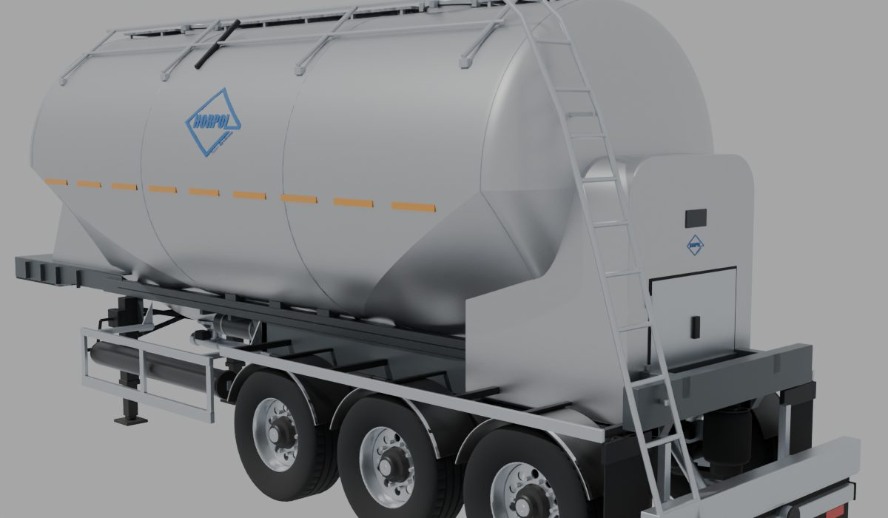
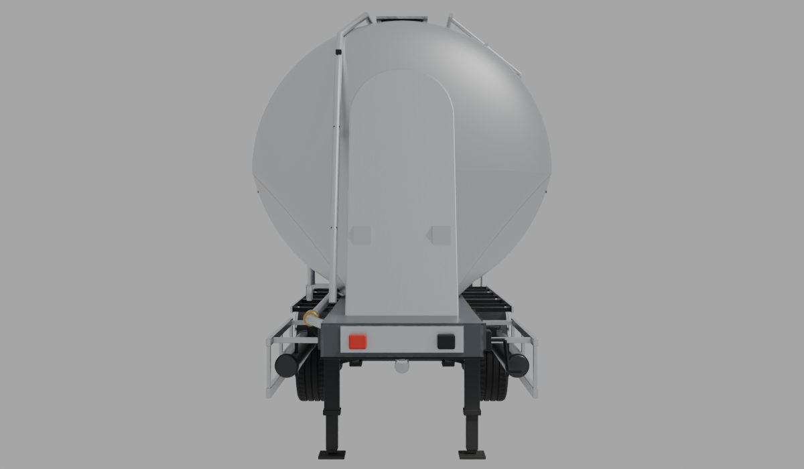
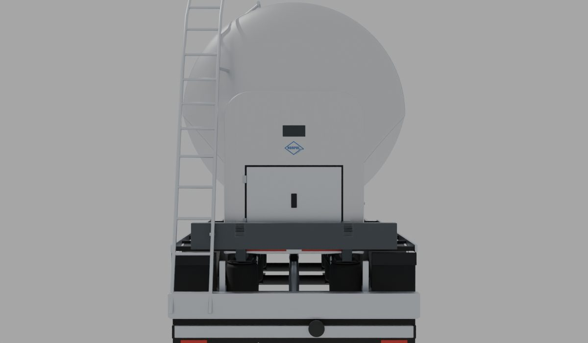
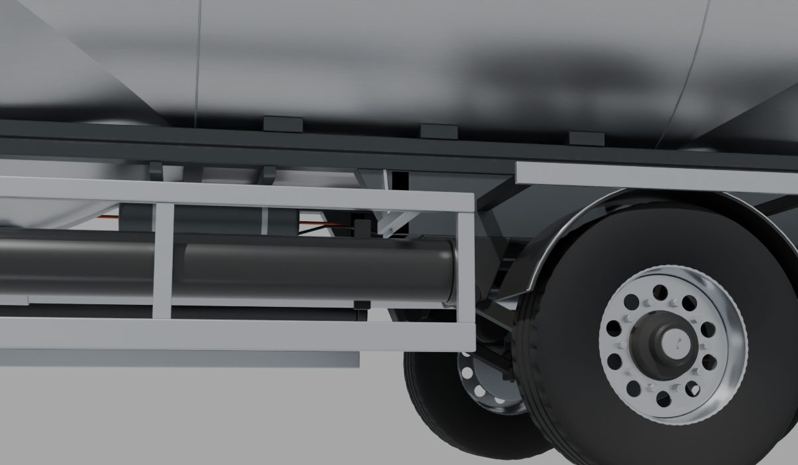
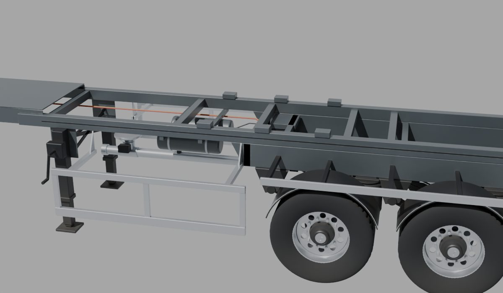

# Silobas Dorse (devrilmeyen alüminyum silo, 33 m³, 3 akslı)

Konfigüratördeki **silo** tipinin 3D modeli: referans, ölçüler, kararlar, üretim hattı ve ölçümler.
Model Blender betiğiyle üretilir; sayıların tek kaynağı [`tools/blender/silo.py`](../../tools/blender/silo.py).
Bu belge betikteki değerlerin özeti ve gerekçesidir; betik ile çelişirse betik geçerlidir.
Ortak hat ve yöntem standart dorseyle aynıdır: [Standart Dorse](../Standart%20Dorse/README.md).

Durum: 2026-10-19'da **K.SSL 33**'e göre yeniden yapıldı. 2026-10-18 sürümü yanlış referansa (K.SSL 38: 10,8 m, 3 kapak,
uzun eğik burun) göre yapılmıştı; kullanıcı düzeltti. Vault'taki `Teknik Data/Bulk Silo Dorse/silo-data.pdf` zaten K.SSL 33 broşürüdür.




## 1. Referans

| Kaynak | Ne alındı |
|---|---|
| [Kässbohrer K.SSL 33 / 2-10/24_EU ürün sayfası](https://kaessbohrer.com/en/products/silo-596-c/non-tipping-598-c/kssl-33-2-10-24-eu) | Teknik tablo, yapı tanımı |
| [Ürün broşürü (PDF, 2 sayfa)](https://www.kaessbohrer.com/uploads/static/media/product/715/attachments/auto_pdf/brochure_715_en.pdf) (= vault `silo-data.pdf`) | Teknik tablo, **ölçekli yan/arka görünüş çizimi** (1500×550, PDF'e gömülü), arka 3/4 fotoğraf |
| Vault `Teknik Data/Bulk Silo Dorse/` görselleri (Öztreyler 34 m³ alüminyum silo render'ları ve fotoğrafları) | Biçim: üstte silindir, uçlarda alt yarının huniye dönmesi, önde king pin'e inen burun kulesi, arkada dikey arka kule, merdiven, yan koruma |

Kässbohrer ve Öztreyler görselleri telifli olduğu için repoya kopyalanmadı; yalnız ölçü ve yapı referansı. Üretici renkleri ve
logoları kullanılmaz; yalnız Horpol logosu.

## 2. Teknik tablo (broşür)

| Ölçü | Değer |
|---|---|
| Dış boy (L) | 9.385 mm |
| Tank çapı (D) | 2.550 mm |
| Eyer yüksekliği H5 | 1.220 mm |
| Hacim | 33,0 m³, 1 bölme |
| Kapaklar | 2 × DN450 basınçlı |
| Boşaltma | Arkadan (boru şasinin altından) |
| Hortum taşıyıcı | 2 × NW100, 5 m, arka kapaklı |
| Şasi | Alüminyum ekstrüzyon profil, destek konsolunun içine kaynaklı |
| Akslar | 3 BPW havalı süspansiyon, 9 t; EBS 2S/2M |
| Lastik | 385/65 R22,5 |
| Boş ağırlık | 4.415 kg (±%3) |
| Çalışma / test basıncı | 2,0 / 3,0 bar |
| Aydınlatma | ASPÖCK, 24 V LED yan pozisyon; 2 × 7 ve 1 × 15 pin soket |

## 3. Çizimden ölçülenler

Broşür PDF'ine gömülü 1500×550 çizim piksel ölçümüyle okundu (gömülü görsel `tools` dışında, yerelde çıkarıldı; repoda yok).
Ölçek **80,8 px/m**: L = 9,385 m ölçü çizgisinden; akslar arası (A = 1,31 m) ve H5 (1,22 m) ile tutarlı.

| Ne | Değer (arka uca göre x) | Not |
|---|---|---|
| King pin | −8,885 m | Önden 0,50 m (DLRv) |
| Dingil mesafesi | 6,49 m | King pin → orta aks |
| Akslar | −3,705 / −2,395 / −1,085 m | Aralık 1,31 m |
| İniş ayağı | −6,81 m | |
| Tank üstü | 3,87 m | Ø2,55 → ekvator 2,59 m, alt 1,32 m |
| Silindir | −7,45 … −1,40 m | Ön bombe ucu ~−7,97, arka ~−0,98 |
| Huniler | Önde −7,45 → −5,35, arkada −3,55 → −1,40 | Yan görünüşte kırılma çizgisi ekvatordan orta alta iner |
| Kapaklar | −6,13 / −2,78 m | |
| Burun kulesi ön çizgisi | (−8,79; 1,45) → (−7,92; 3,40) | Önden görünüşte ~0,84 m genişlik, üstü yuvarlak |
| Arka kule | 1,48 m genişlik, üstü 2,78 m | Arka görünüş; dolap kapağı ~1,0 × 0,74 m |
| Merdiven | sol arka (+z), z 0,82–1,20 m | Arka görünüş |
| Yan koruma + hortum taşıyıcı | −6,62 … −4,48 m, 0,50–1,06 m | İniş ayağı ile ön aks arası |
| Lamba barı / alt koruma | 0,50–0,74 / 0,30–0,42 m | Arka görünüş |

## 4. Doğrulanmadı / varsayım

- **Huni kesiti:** üstte daire yayı, kırılma noktasından tabana hafif dışbükey yanlarla iner (koni kesiti). Kırılma
  yüksekliği yan görünüşteki çizgiden doğrusal; taban çizgisi (ağızlarda ~1,03 m) ve ağızların yeri (−6,25 / −2,65 m) tahmin.
- **Kuleler:** burun kulesinin ve arka kulenin derinliği (tankın içine gömülü kısım) ve arka kulenin dik yüzü (çizimde hafif eğik).
- Ana kirişlerin yeri ve kesiti (z ±0,55 m, 1,27–1,41 m; tankın altına oturur), aks bölgesi alt çerçevesi (1,00–1,27 m); şasi altı
  fotoğrafı yok.
- Hortum taşıyıcı: her yanda bir boru yan korumanın içinde (çizimdeki kutu 2,1 m; 5 m hortum için kısa, doğrulanmadı).
- Havalandırma borusu (çizimdeki U boru, orta solda) ve hava hatlarının güzergâhı.
- Model tek boyda (9,385 m). Set uzunluğundan bağımsız.

## 5. Koordinatlar ve ana ölçüler (betikteki sabitler)

three.js düzeni: **x boyuna** (arka uç 0, ön −9,385), **y yukarı**, **z yanal** (+z sol, genel görünümde kameraya bakan yan).

| Sabit | Değer | Anlam |
|---|---|---|
| `XF` | −9,385 | Konsolun ön yüzü (soketler) |
| `RT` / `YC` | 1,275 / 2,59 | Tank yarıçapı / ekvator |
| `XHF`, `DF` / `XHR`, `DR` | −7,45, 0,52 / −1,40, 0,42 | Kapak tabanları ve bombe derinlikleri |
| `XM0` / `XM1` | −5,35 / −3,55 | Tam silindir bölgesi |
| `OUT` | −6,25 / −2,65 | Boşaltma ağızları |
| `BZ` / `BOT` / `BTOP` | 0,55 / 1,27 / 1,41 | Ana kiriş ekseni / altı / üstü |
| `SUB_BOT` | 1,00 | Aks bölgesi alt çerçeve altı (askılar) |
| `HY` | 1,45 | Tesisat düzlemi (kirişlerin üstü, tankın altı) |

## 6. Model yapısı

**Şasi (`silo-chassis.glb`, tesisat görünümünde görünür):** king pin plakası ve 2" pim, kutu konsol (yan levhalar, kaburgalar,
soket levhası, palm kavramalar), alüminyum kutu ana kirişler ve traversler, tank takozları, aks bölgesi alt çerçevesi, iniş
ayakları, 3 aks BPW havalı süspansiyon ve disk fren, kavisli siyah çamurluklar (paslanmaz kenar), çamurluk rayı, paçalar,
alüminyum yan koruma (iki ray, dikmeler, kollar), hava tankları, EBS, hava hatları ve fren hortumları, iki huni ağzı
(havalandırma konisi, kelebek vana, pnömatik tahrik), alt boşaltma borusu (arkada tamponun altında rakor), alüminyum lamba barı,
alt koruma tamponu, paça levhası (beyaz logo).

**Tank (`silo-body.glb`):** tek parça kabuk (halkalardan örülür: ön bombe, uçlarda huniye dönen alt yarı, orta tam silindir,
arka bombe), kaynak dikişleri, 2 kapak boynu, burun kulesi, arka kule. **Üst yapı:** kapaklar ve kenet cıvataları, yürüme yolu
(kaymaz sac), katlanmış korkuluk, sol arka merdiven (tutamaklı), her yanda hortum taşıyıcı (arka kapaklı), havalandırma
borusu, yan hava hattı (huni beslemeleri, çek valf, manometre), ön üst hava hattı, ön lamba pabuçları, dolap kapağı ve
ayrıntıları, sarı yan kontur bandı, iki yanda ve arka kulede logo.

**Tesisat görünümünde** tankın yerini halka kesitleri, orta düzlem siluet, ekvator çevresi, kule konturları ve kapaklar gösterir.

## 7. Renk düzeni ve dokular

| Parça | Renk / malzeme |
|---|---|
| Tank, kuleler | Doğal fırçalanmış alüminyum (boyuna ince fırça izi) |
| Şasi, konsol, hava tankları | Antrasit RAL 7016, saten |
| Yan koruma, lamba barı, tampon, borular | Çıplak alüminyum |
| Süspansiyon, akslar, iniş ayakları | Siyah |
| Çamurluklar, hortum taşıyıcılar | Siyah plastik; çamurlukta paslanmaz kenar |
| Jantlar | Cilalı alüminyum |

Referans fotoğraflarda tank beyaz/kırmızı boyalı; Horpol modelinde doğal alüminyum (öneri, onay bekliyor; kullanıcı mevcut
renklerden memnun olduğunu söyledi, 2026-10-19).

**Tank kabuğu:** tekrarlanan 0,9 m karo (512²) yalnız boyuna fırça izi. AO ikinci UV'de (`AOUV`, 2048²), glTF occlusion `texCoord: 1`.
**Şasi, tekerlek, üst yapı:** AO + renk/ORM pişirme (`bl_common.bake_surface`).

## 8. Bağlantı noktaları

[`silo-anchors.json`](../../src/configurator/engine/silo-anchors.json) (şema: [`baked.ts`](../../src/configurator/engine/baked.ts)):

| Ne | Yer |
|---|---|
| Stop lambaları | Alüminyum lamba barı, x = 0; y 0,62; z ±0,96 ve ±0,56 |
| Plaka | y 0,62, lamba barı ortası |
| Yan markerlar | Önde yan koruma üst rayı (y 1,03), aks bölgesinde çamurluk rayı (y 1,14) |
| Ön pozisyon | Burun kulesinin ön yüzü (y 2,05, z ±0,30) |
| Gabari | Tank yanında, önde x −7,25, arkada x −1,6 (y 2,7) |
| Ek lambalar | Arka kulenin arka yüzü, y 2,55 |
| Soketler | Konsolun ön yüzü, y 1,36 |
| Tesisat | Konsol içinde y 1,36, kirişlerin üstünde y 1,45; yan ana hat z ±0,66, arka hatlar z ±0,40 |

## 9. Üretim hattı

```bash
blender -b -P tools/blender/silo.py          # tam kalite; --fast deneme; --anchors yalnız JSON; --preview <klasör>
npm run models:pack -- silo
```

## 10. Ölçümler

| Ölçüm | Değer |
|---|---|
| Model indirme | 2,50 MB (gzip 1,91 MB): şasi 1,44 MB, tank + üst yapı 1,11 MB. Önceki K.SSL 38 sürümü 2,73 MB |
| Üçgen | şasi 57,5 bin, tekerlek 17,7 bin (× 6), tank + kuleler 31,9 bin, üst yapı 14,6 bin |
| Tank hacmi (halka kesitlerinden) | 33,3 m³ (tablo 33,0) |
| Sitede (tüm lambalar 2'şer, gölge geçişi dahil) | genel görünüm 171 çizim çağrısı, 491 bin üçgen; tesisat 159 / 398 bin. Hata/NaN yok |

## 11. Sonraki işler (öneri)

- Hacim seçenekleri (31–54 m³) farklı boy ve aks düzeniyle ayrı sabitlerle üretilebilir.
- Kompresör, yan boşaltma, çift bölme seçenekleri eklenmedi.

## 12. Görseller

| | |
|---|---|
Blender önizleme render'ları (`--preview`), 2026-10-19:

| | |
|---|---|
| Yan  | Ön 3/4  |
| Arka 3/4  | Önden  |
| Arkadan  | Alt (yan koruma, hortum taşıyıcı)  |
| Şasi (tesisat görünümündeki gibi, tank gizli)  | |
