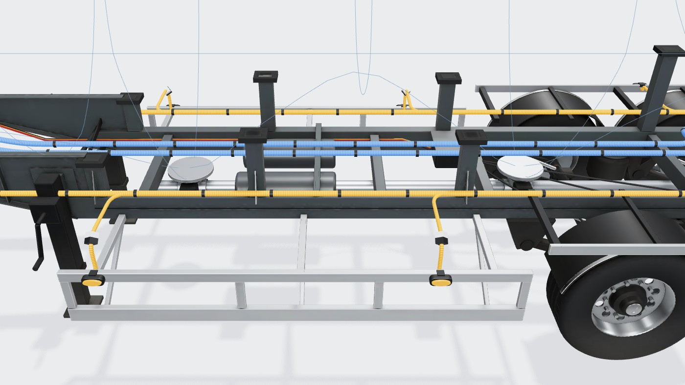
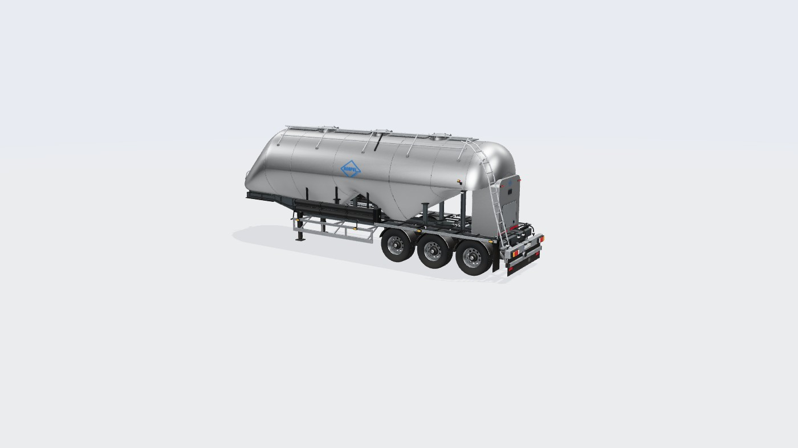
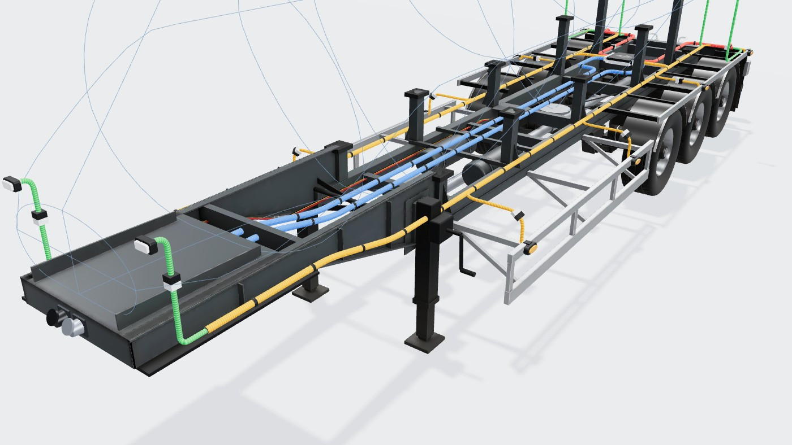

# Silobas Dorse (devrilmeyen "W" tipi alüminyum silo, 3 akslı)

Konfigüratördeki **silo** tipinin 3D modeli: referans, ölçüler, kararlar, üretim hattı ve ölçümler.
Model Blender betiğiyle üretilir; sayıların tek kaynağı [`tools/blender/silo.py`](../../tools/blender/silo.py).
Bu belge betikteki değerlerin özeti ve gerekçesidir; betik ile çelişirse betik geçerlidir.
Ortak hat ve yöntem standart dorseyle aynıdır: [Standart Dorse](../Standart%20Dorse/README.md).

Durum: 2026-10-18'de kodlandı.




## 1. Referans

| Kaynak | Ne alındı |
|---|---|
| [Kässbohrer K.SSL 38 / 2-10/24 ürün sayfası](https://kaessbohrer.com/en/products/silo-596-c/non-tipping-598-c/kssl-38-2-10-24) | Teknik tablo, yapı tanımı |
| [Ürün broşürü (PDF, 2 sayfa)](https://www.kaessbohrer.com/uploads/static/media/product/716/attachments/auto_pdf/brochure_716_en.pdf) | Teknik tablo, **ölçekli yan/arka görünüş çizimi**, arka 3/4 fotoğraflar |
| [Silo serisi kataloğu (PDF)](https://kaessbohrer.com/uploads/2025/2/silo-trailers-en-v5-2025-02-07-105048.pdf) | Seri tablosu: "W" tipi alüminyum tank, rulo şekilli boşaltma konileri, alüminyum kutu "yarım şasi", alüminyum boşaltma hattı arkada tampon altında biter, 2 × DN200 5 m hortum borusu sağ-sol, 2 × 12 t JOST iniş ayağı, 22,5" disk fren |
| [Satıcı ilanı fotoğrafları (K.SSL 31-35-38)](https://www.truckscout24.com/tsp/ts-213-65-457) | **Önden** görünüş: tankın eğik burun konisi king pin konsoluna iner; yan "W" yüzleri düzleme yakın; yan çerçeve, hortum boruları, arka dolap, merdiven |

Kässbohrer görselleri telifli olduğu için repoya kopyalanmadı. Üretici kırmızısı ve logosu kullanılmaz; yalnız Horpol logosu.

## 2. Teknik tablo (broşür)

| Ölçü | Değer |
|---|---|
| Tank çapı (D) | 2.550 mm |
| Eyer yüksekliği H5 | 1.220 mm |
| Dingil mesafesi (Wb) | **7.615 mm** (tablo) — çizimde **7.815 mm** |
| Dış boy (L) | **10.605 mm** (tablo) — çizimde **10.823 mm** |
| Hacim | 38 m³, 1 bölme, 2 koni |
| Kapaklar | 3 × DN450 basınçlı |
| Boşaltma | Arkadan |
| Hortum taşıyıcı | 2 × NW100, 5 m, arka kapaklı |
| Şasi | Alüminyum ekstrüzyon profil, destek konsolunun içine kaynaklı |
| Akslar | 3 BPW havalı süspansiyon, 9 t |
| Lastik | 385/65 R22,5 |
| Çalışma / test basıncı | 2,0 / 3,0 bar |

**Çelişki:** tablo ile çizim dingil mesafesinde 200 mm, boyda 218 mm farklı. Model **çizimi** izler (çizim ölçeği
akslar arası 1.310 ile doğrulandı; tablo başka bir yapılandırmaya ait olabilir). Doğrulanmadı.

## 3. Çizimden ve fotoğraftan ölçülenler

Yan görünüş çizimi piksel ölçümüyle okundu. Ölçek **79,92 px/m** (10.823 ölçü çizgisi; akslar arası 1,31 m ile tutarlı).

| Ne | Değer | Not |
|---|---|---|
| King pin | arka uca 10,315 m | Orta aksa 7,815 m |
| İniş ayağı | king pinin 2,25 m arkasında | Çizimdeki 2250 ölçüsü |
| Akslar | −3,81 / −2,50 / −1,19 m | Aralık 1,31 m |
| Tank üstü | 3,79 m | Ø2,55 → ekvator 2,515 m |
| Kapak üstü | 3,934 m | = toplam yükseklik |
| Kapaklar | x = −7,27 / −5,12 / −2,97 m | Aralık 2,15 m |
| Burun | önden ~56° eğimle konsola iner | Çizimde eğik ön çizgi; ilan fotoğrafı doğruluyor |
| Boşaltma ağızları | x ≈ −7,17 ve −4,40 m, alt ~1,0 m | İki koninin en alt noktası ("W") |
| Arka dolap | 1,5 m genişlik, 1,1–2,8 m | Arka görünüş |
| Merdiven | sol arka (+z), z 0,80–1,17 m | Arka görünüş |
| Yan çerçeve | raylar 0,86–0,94 ve 0,49–0,61 m | İniş ayağının arkasından ön aksa |
| Lastik dış yüzü | ±1,23 m | Arka görünüş |

## 4. Doğrulanmadı / varsayım

- Koni eğimleri ve "W" alt çizgisi: ağızlar ve sırt (−5,78 m, 1,86 m) çizim ve fotoğraftan yaklaşık; kesit üst yarıda daire,
  alt yarıda süper elips (yan yüzler düzleme yakın).
- Burun: konsol üstündeki küçük ön levha (Ø~0,9 × 0,5 m) ve genişlik dağılımı fotoğraftan tahmin.
- Ana kirişlerin yeri ve kesiti (z ±0,52 m, 0,88–1,08 m), tank yatakları, konsol ayrıntıları; şasi altı fotoğrafı yok.
- Hortum borularının boyu (fotoğraftaki oranla 3,2 m; tabloda 5 m hortum).
- Model tek boyda (10,82 m). Set uzunluğundan bağımsız.

## 5. Koordinatlar ve ana ölçüler (betikteki sabitler)

three.js düzeni: **x boyuna** (arka uç 0, ön −10,82), **y yukarı**, **z yanal**.

| Sabit | Değer | Anlam |
|---|---|---|
| `XF` | −10,64 | Konsolun ön yüzü (soketler) |
| `XN` | −10,58 | Burnun ön levhası |
| `XH` | −1,42 | Arka kapak tabanı (kapak −0,66'ya kadar) |
| `RT` / `YC` | 1,275 / 2,515 | Tank yarıçapı / ekvator |
| `OUT` | −7,17 / −4,40 | Boşaltma ağızları |
| `BZ` / `BOT` / `BTOP` | 0,52 / 0,88 / 1,08 | Ana kiriş ekseni / altı / üstü |
| `CON_TOP` | 1,42 | Destek konsolu üstü |
| `HY` | 1,18 | Tesisat düzlemi (kirişlerin üstü, tankın altı) |

## 6. Model yapısı

**Şasi (`silo-chassis.glb`, tesisat görünümünde görünür):** king pin plakası ve 2" pim, destek konsolu (yan levhalar,
kaburgalar, ön levha, burun yatakları), alüminyum kutu ana kirişler ve traversler, tank yatakları (kirişten tankın altına),
alüminyum yan çerçeve (yan koruma: iki ray, dikmeler, kollar), iniş ayakları, 3 aks BPW havalı süspansiyon ve disk fren,
tekerlek başına kavisli siyah çamurluk (paslanmaz kenar), çamurluk rayı (yan markerlar), paçalar, hava tankları, EBS, hava
hatları ve fren hortumları, boşaltma: iki koni ağzı (havalandırma konisi, kelebek vana, pnömatik tahrik), alt boşaltma
borusu arkada tampon altında rakorla biter, alüminyum lamba barı, alt koruma tamponu, paça levhası (beyaz logo).

**Tank (`silo-body.glb`):** tek parça kabuk (halkalardan örülür: burun konisi, "W" gövde, bombeli arka kapak), kaynak
dikişleri, 3 kapak boynu, arka boşaltma dolabı. **Üst yapı:** kapaklar ve kenet cıvataları, yürüme yolu (kaymaz sac),
katlanmış korkuluk (menteşe braketleri, dikmeler, üst ve diz rayı, pnömatik silindir), sol arka merdiven, her yanda iki
siyah hortum borusu (üç parça, arka kapaklı kutu, tanka askılar), yan hava hattı (pirinç çek valf), ön üst hava hattı (burun
boyunca), ön tutamak, ön lamba pabuçları, dolap kapağı, kulplar, gösterge penceresi, iki yanda ve dolapta logo.

**Tesisat görünümünde** tankın yerini halka kesitleri, orta düzlem siluet (burun, üst çizgi, "W" alt çizgi), ekvator çevresi ve
kapaklar gösterir.

## 7. Renk düzeni ve dokular

| Parça | Renk / malzeme |
|---|---|
| Tank, dolap | Doğal fırçalanmış alüminyum (boyuna ince fırça izi) |
| Şasi, konsol, tank yatakları, hava tankları | Antrasit RAL 7016, saten |
| Yan çerçeve, lamba barı, tampon, borular | Çıplak alüminyum |
| Süspansiyon, akslar, iniş ayakları | Siyah |
| Çamurluklar, hortum boruları | Siyah plastik; çamurlukta paslanmaz kenar |
| Jantlar | Cilalı alüminyum |

Referans fotoğraflarda tank beyaz boyalı; Horpol modelinde doğal alüminyum seçildi (birçok silo tankı çıplak alüminyumdur;
beyaz tanker ve antrasit lowbed ile ayrışır). Öneri, tasarım kararı (onay bekliyor).

**Tank kabuğu:** tekrarlanan 0,9 m karo (512²) yalnız boyuna fırça izi; iki boyutlu pürüzlülük lekesi yoktur (ilk denemede
geniş metal yüzeyde yansımada dalga gibi görünüyordu). AO ikinci UV'de (`AOUV`, 2048²), glTF occlusion `texCoord: 1`.
**Şasi, tekerlek, üst yapı:** AO + renk/ORM pişirme (`bl_common.bake_surface`: toz, kenar aşınması, pürüzlülük).

## 8. Bağlantı noktaları

[`silo-anchors.json`](../../src/configurator/engine/silo-anchors.json) (şema: [`baked.ts`](../../src/configurator/engine/baked.ts)):

| Ne | Yer |
|---|---|
| Stop lambaları | Alüminyum lamba barı, x = 0; y 0,81; z ±0,96 ve ±0,56 |
| Plaka | y 0,81, lamba barı ortası |
| Yan markerlar | Önde yan çerçeve üst rayı (y 0,90), aks bölgesinde çamurluk rayı (y 1,14) |
| Ön pozisyon | Burnun alt köşelerinde pabuçlar (y 1,95, z ±0,62) |
| Gabari | Tank yanında, önde x −8,8, arkada x −1,55 (y 2,7) |
| Ek lambalar | Arka dolabın üst köşeleri, y 2,62 |
| Soketler | Konsolun ön yüzü, y 1,33 |
| Tesisat | Konsol içinde y 1,33, kirişlerin üstünde y 1,18; yan ana hat z ±0,66, arka hatlar z ±0,40 |

## 9. Üretim hattı

```bash
blender -b -P tools/blender/silo.py          # tam kalite ~9 dk; --fast ~2,5 dk; --anchors yalnız JSON
npm run models:pack -- silo
```

## 10. Ölçümler

| Ölçüm | Değer |
|---|---|
| Model indirme | 2,73 MB (gzip 2,02 MB) |
| Üçgen | şasi 57,9 bin, tekerlek 17,7 bin (× 6), tank 44,5 bin, üst yapı 20,8 bin |

Not: ilk denemede tank sitede siyah göründü; sitenin geometri birleştirmesi ikinci UV'yi (`uv1`) siliyordu ve AO dokunun
siyah köşesinden okunuyordu. `trailer.ts → mergeByMaterial` artık `uv1`'i korur.

## 11. Sonraki işler (öneri)

- Hacim seçenekleri (31–54 m³) farklı boy ve aks düzeniyle ayrı sabitlerle üretilebilir.
- Kompresör, yan boşaltma hunisi, çift bölme seçenekleri eklenmedi.

## 12. Görseller

| | |
|---|---|
| Genel  | Arka 3/4  |
| Ön 3/4  | Tesisat, ön  |
| Tesisat, orta  | |
