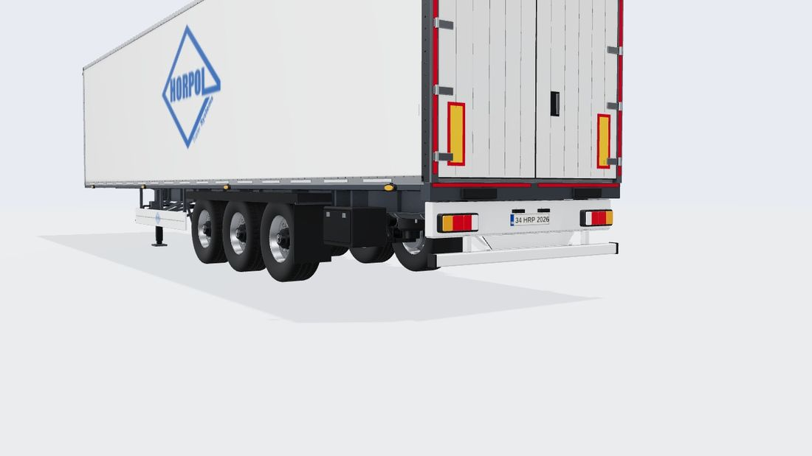
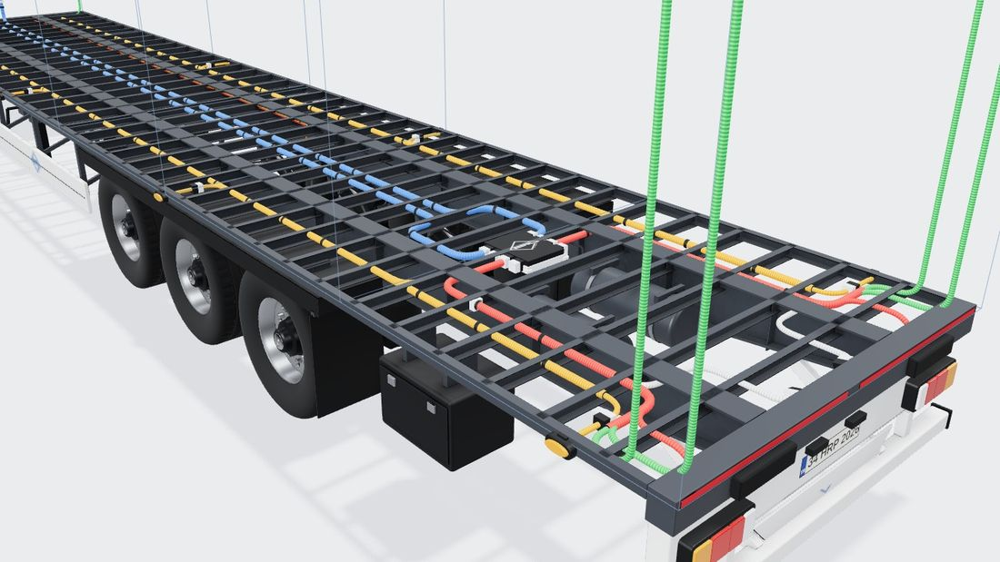
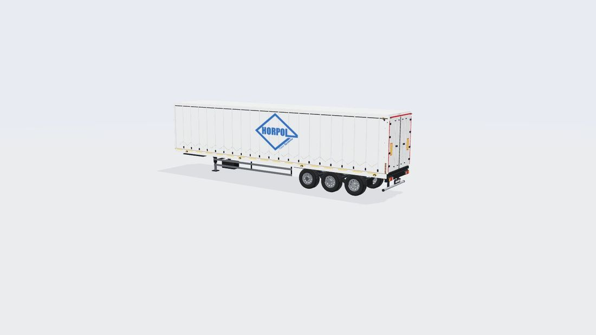
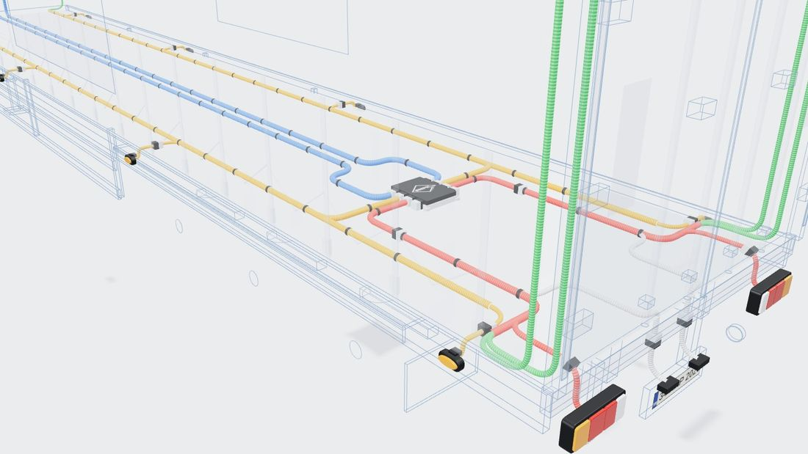
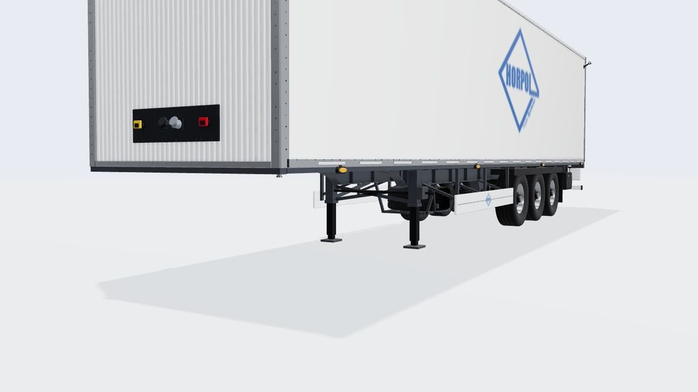
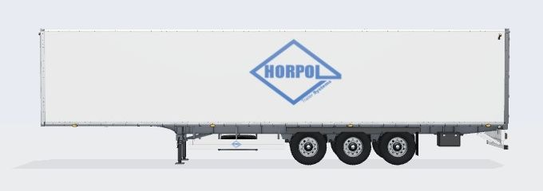
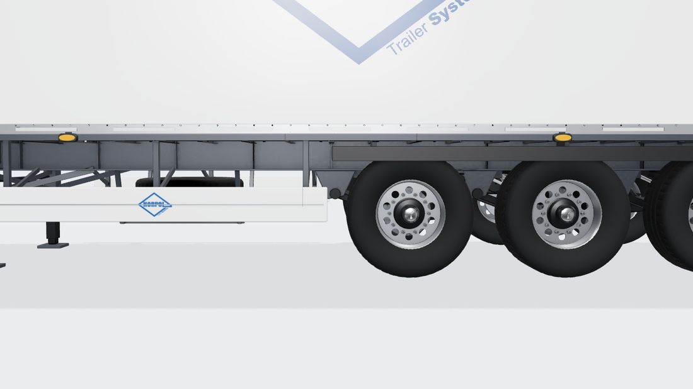
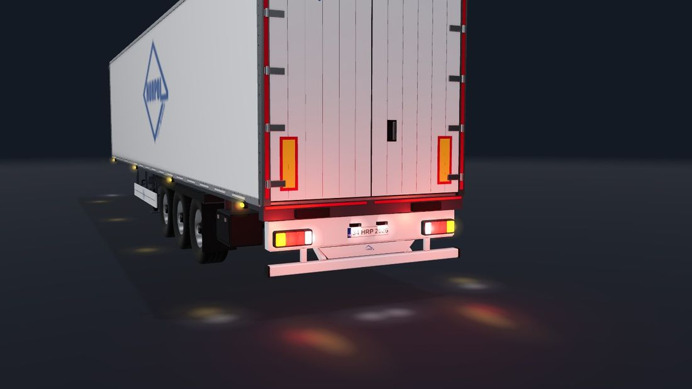
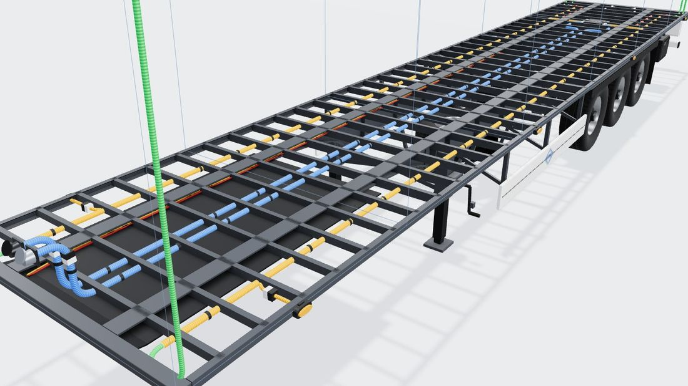
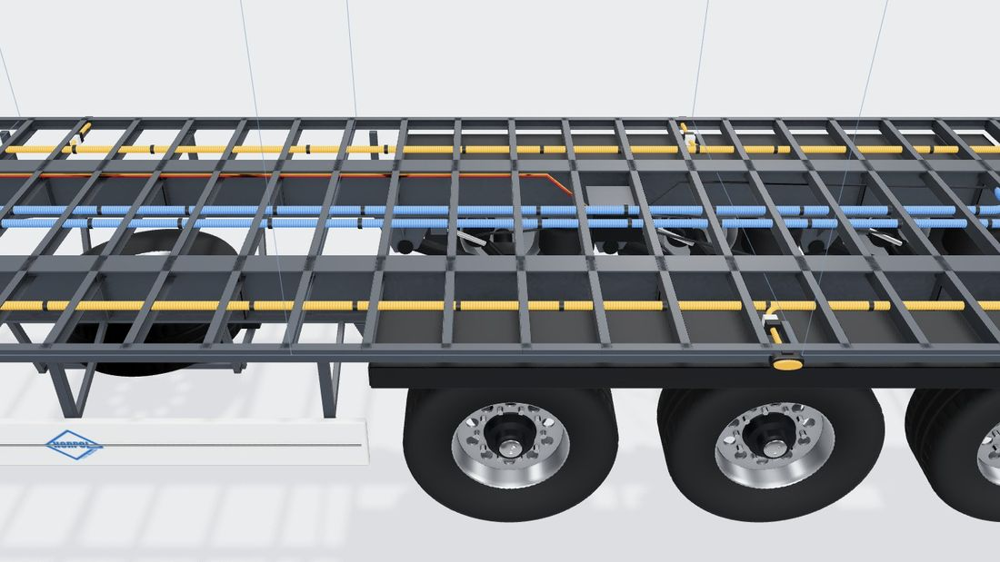

# Standart Dorse (kuru yük kapalı kasa)

Konfigüratördeki **standart** tipinin 3D modeli: referans, ölçüler, kararlar, üretim hattı ve ölçümler.
Model Blender betiğiyle üretilir; sayıların tek kaynağı [`tools/blender/standart_box.py`](../../tools/blender/standart_box.py).
Bu belge betikteki değerlerin özeti ve gerekçesidir; betik ile çelişirse betik geçerlidir.

Durum: 2026-10-18'de kodlandı. "Standart = kapalı kasa" kararı **Önerilen** (kullanıcı onayı bekliyor; önceki model tenteliydi).




## 1. Referans

| Kaynak | Ne alındı |
|---|---|
| [Kässbohrer K.SBT / 20-12/27 ürün sayfası](https://kaessbohrer.com/en/products/box-639-c/dry-freight-box-640-c/ksbt-20-12-27) | Teknik tablo, yapı tanımı |
| [Ürün broşürü (PDF, 2 sayfa)](https://www.kaessbohrer.com/uploads/static/media/product/619/attachments/auto_pdf/brochure_619_en.pdf) | Teknik tablo + **ölçekli yan/arka görünüş çizimi** + arka 3/4 fotoğraf |
| [Box & Reefer broşürü (PDF, 7 sayfa)](https://kaessbohrer.com/uploads/2025/1/box-refeer-en-v5-2025-01-30-231119.pdf) | Seri tablosu (dingil mesafeleri, şasi tipi), standart özellik görselleri (KTL şasi, oluklu çelik ön panel, alüminyum profil kapı) |
| [BPW ECO Air teknik dokümanları](https://www.bpw.de/uploads/tx_szdownloadcenter/ECO_Air_COMPACT_Kit_overview_disc_brake_18011701e.pdf) | Askı braketi yüksekliği (205/290 mm), körük Ø360 mm, aks–körük ekseni ~405 mm |

Kässbohrer görselleri telifli olduğu için repoya kopyalanmadı; yukarıdaki bağlantılardan indirilebilir.
Üretici logosu modelde **kullanılmaz** (yalnız Horpol logosu).

## 2. Teknik tablo (broşür)

| Ölçü | Değer |
|---|---|
| Toplam boy (L) | 13.700 mm |
| İç boy | 13.620 mm |
| Toplam genişlik | 2.550 mm |
| İç genişlik | 2.490 mm |
| Toplam yükseklik | 4.020 mm |
| İç yükseklik | 2.725 mm |
| Arka giriş yüksekliği | 2.685 mm |
| Eyer (kavrama) yüksekliği H5 | 1.150 mm |
| Dingil mesafesi (king pin → orta aks) | 7.455 mm |
| Akslar | 3 × 9 t BPW, diskli fren, havalı süspansiyon |
| Lastik | 385/65 R22,5 (Ø 1.072 mm → R = 0,536 m) |
| Şasi | S460MC, iki kaynaklı I kiriş, traversler; KTL kaplı, boyunlu (gooseneck) |
| Yan duvar | 20 mm GRP-kontrplak-GRP; alt ve üst alüminyum köşe profilleri |
| Taban | 30 mm fenolik kaplı kontrplak |
| Ön panel | KTL kaplı çelik (dikey oluklu) |
| Tavan | Yarı saydam beyaz GRP, galvaniz omega takviyeli |
| Arka kapı | 2 kanat alüminyum profil, gizli kilit, kanat başına 5 menteşe |
| Aydınlatma | Önde 4 beyaz LED poz., arkada 2 kırmızı üst LED, yanda duvar başına 4 turuncu LED marker |

## 3. Çizimden ölçülenler

Broşürdeki yan görünüş çizimi piksel ölçümüyle okundu. Ölçek **70,4 px/m**; hem boy (13,7 m) hem yükseklik (4,02 m)
ile ayrı ayrı doğrulandı, lastik yarıçapı ve aks aralığı (1,31 m) da bu ölçekle tutuyor.

| Ne | Değer (ön uca göre) | Not |
|---|---|---|
| King pin | 1,70 m | AB kuralı: king pin → arka ≤ 12,0 m ⇒ ≥ 1,70 m; çizim 1,71 |
| Boyun eğrisi | 2,60 → 3,90 m | Önde basık (kavrama plakası 1,15 m), arkada derin kiriş (alt 0,895 m) |
| İniş ayağı | ~4,0 m | Boyun bitişinde |
| Travers aralığı | ~0,36 m | Yan rayın altındaki uç izlerinden |
| Yan koruma | 0,48–0,77 m yükseklik | Tek beyaz profil, iniş ayağı ile ön aks arası |
| Yedek lastik sepeti | 5,2–6,3 m, 0,31–0,87 m yükseklik | Yatık, kirişlerin altında |
| Alet kutusu | Arkadan 1,4–2,0 m | Son aksın arkasında |
| Hava tankları | Arkada, kirişler arası, z ≈ ±0,30 m | Arka görünüşte iki daire |
| Lamba taşıyıcı | 0,74–1,05 m | Beyaz; stop lambaları z ≈ ±0,93 m |
| Plaka merkezi | 0,865 m | Lambaların arasında |
| Alt koruma tamponu | 0,48–0,57 m | Logolu levha + çapraz dikmeler |
| Arka süspansiyon izi (arka görünüş) | z ≈ ±0,575 m | Ana kiriş eksenini (±0,55 m) buradan çıkardık |

**Çelişki:** Çizimdeki aks konumu, tablodaki dingil mesafesinden ~0,24 m farklı (çizim seri için genel).
**Tablodaki değer esas alındı:** akslar arka uca göre −5,855 / −4,545 / −3,235 m.

## 4. Doğrulanmadı / varsayım

- Şasi altı fotoğrafı bulunamadı. Kiriş aralığı (±0,55 m), travers profilleri (C, 63–80 mm), boyun içi yapı,
  EBS ve hava hattı güzergâhı genel AB kuru yük dorsesi bilgisine dayanır.
- Taban üstü 1,255 m: iç yükseklik + 4,02 toplam yükseklikten hesap (tavan kalınlığı ~0,04 m varsayımı).
- KTL kaplama gerçekte siyaha yakın. Tesisat görünümünde biçim okunsun diye **koyu antrasit** (`#40454c`) seçildi.
- Model tek boyda (13,7 m). Konfigüratörde 13,6 / 12 / 9 m setlerin hepsinde aynı dorse görünür (damper'daki gibi).

## 5. Koordinatlar ve ana ölçüler (betikteki sabitler)

three.js düzeni: **x boyuna** (arka uç 0, ön −13,7), **y yukarı**, **z yanal** (+z genel görünümde kameraya bakan yan).

| Sabit | Değer | Anlam |
|---|---|---|
| `FLOOR_TOP` | 1,255 | Taban üstü |
| `CH_TOP` | 1,225 | Kiriş ve travers üstü = taban altı |
| `NECK_BOT` | 1,150 | Kavrama plakası altı (H5) |
| `DEEP_BOT` | 0,895 | Derin kiriş altı |
| `BZ` | 0,55 | Ana kiriş gövde ekseni (yanal) |
| `WZ` | 1,02 | Tekerlek merkezi (iz ~2,04 m) |
| `RAIL_Z` | 1,265 | Dış yan ray dış yüzü |
| `KING_X` | −12,00 | King pin |
| `LEG_X` | −9,68 | İniş ayağı |
| `HARNESS_Y` | 1,18 | Tesisat düzlemi (travers gövdelerinden geçer) |

## 6. Model yapısı

**Şasi (`standart-chassis.glb`, tesisat görünümünde görünür):** iki I kiriş (önde basık boyun, Bezier eğriyle derinleşir,
arkada incelir), 37 C travers (kiriş gövdesinden geçer), dış C yan raylar, ön ve arka travers, king pin plakası ve 2" pim,
iniş ayakları (dişli kutusu ve kol +z'de, çaprazlar), 3 aks BPW tipi havalı süspansiyon (askı braketi, salıncak kolu, U cıvata,
Ø360 körük, amortisör), disk fren (disk, kaliper, içe bakan fren silindiri), düz çamurluklar ve paçalar, beyaz yan koruma
(logolu), yatık yedek lastik sepeti, iki hava tankı, EBS modülatörü, kırmızı/sarı hava hatları ve fren hortumları,
alet kutusu (+z), beyaz lamba taşıyıcı, alt koruma tamponu ve logolu levha, rampa tamponları, kırmızı kontur bandı.
Tekerlek tek model, 7 örnek (6 + yedek); sitede örnekli çizimle (InstancedMesh) tek kopya bellek.

**Kasa (`standart-body.glb`, tesisat görünümünde gizlenir):** tek yüzlü yan paneller, yuvarlak köşeli alüminyum
alt/üst profiller ve perçin sıraları (~500), L ön köşe dikmeleri, dikey oluklu çelik ön panel (36 oluk), bağlantı
konsolu ve hava kavramaları, yarı saydam tavan ve omega izleri, paslanmaz arka dikmeler ve başlık, profil birleşimli
iki kapı kanadı, 10 menteşe, gizli kilit kolu, conta, ECE R70 plakaları, kırmızı kontur bandı (ECE 104),
yan kontur bandı (beyaz, kesikli), iki yan logo ve sol kapakta küçük logo. Kasa içinde kalan yüzler silinir.

**Tesisat görünümünde** kasanın yerini 7 kesit çerçevesi + 4 boyuna kenar çizgisi gösterir (JSON `sections`).

## 7. Dokular ve kalite

- Ortam örtmesi (AO) Cycles ile pişirilir: şasi ve kasa 2048², tekerlek 1024², 96 örnek, mesafe 0,6 m.
  Şasi ve tekerlekler **kasasız** pişer (tesisat görünümünde kasa gizli, gölgesi şasiye düşmemeli).
- UV atlas: akıllı açma + eşit doku yoğunluğu + paketleme. Oluklu ön panel düzlemsel izdüşürülür
  (bir pikselden dar yüzler dikiş çizgisi bırakmasın).
- Zemin temas gölgesi: dorsenin altındaki düzleme AO (mesafe 1,6 m, 256 örnek), kenarları sıfıra iner, WebP 5 KB.
- Pahlar: Blender Bevel + "harden normals"; ışık kenarlarda çizgi yakalar.

## 8. Bağlantı noktaları (lamba, soket, tesisat)

Betik, modelle aynı ölçülerden [`standart-anchors.json`](../../src/configurator/engine/standart-anchors.json) yazar
(şema: [`baked.ts`](../../src/configurator/engine/baked.ts) → `BakedAnchors`). Özet:

| Ne | Yer |
|---|---|
| Stop lambaları | Lamba taşıyıcı arka yüzü x = −0,08; y 0,86; z ±0,925 ve ±0,5 |
| Plaka | y 0,865, taşıyıcı yüzünde |
| Yan markerlar | Dış yan rayda, y 1,175, x −12,7 … −0,6 |
| Ön pozisyon | Ön köşe dikmelerinin ön yüzü, y 3,86 |
| Gabari (lastik kol) | Yan duvarın üst köşelerinde, y 3,73 |
| Ek lambalar | Arka başlığın arka yüzü, y 3,93 |
| Soketler | Ön paneldeki konsol, y 1,62 |
| Tesisat | y 1,18 düzleminde; ana hat ortada, yan ana hat z ±0,86, arka hatlar z ±0,70; Horpol modülü x −2,2 |

## 9. Üretim hattı

```bash
# 1) Model + AO + temas gölgesi + JSON (Blender 5.2; tam kalite ~5 dk, --fast ~30 sn)
blender -b -P tools/blender/standart_box.py            # --fast: deneme, --anchors: yalnız JSON
# 2) Meshopt sıkıştırma: tools/blender/out → src/assets/models (kuantalama kapalı, Float32)
npm run models:pack -- standart
```

Sitede pişirilmiş tüm tipler tek kayıttan okunur: [`baked.ts`](../../src/configurator/engine/baked.ts)
(GLB adresleri, JSON, kontur çizgileri, temas gölgesi). Yeni tip eklemek için betik + bu kayda bir satır yeterlidir;
`trailer.ts` tipe özel kod istemez. Model yüklenene kadar (ya da yüklenemezse) kodla çizilen kapalı kasa görünür.

Windows: `"C:/Program Files/Blender Foundation/Blender 5.2/blender.exe" -b -P tools/blender/standart_box.py`.
Ortak Blender yardımcıları: [`tools/blender/bl_common.py`](../../tools/blender/bl_common.py).

**Bilinen tuzak (düzeltildi):** `bake_ao` boş malzeme yuvasını başka nesnenin malzemesiyle doldurursa o malzemenin
etkin pişirme düğümü yanlış dokuya döner ve şasi siyah pişer. Artık her nesne kendi malzemesiyle dolar; aynı malzeme
iki pişirme hedefinde olursa betik `UYARI` basar.

## 10. Ölçümler (aynı makine, yazılımsal render, önce `fe1c12f` → sonra)

| Ölçüm | Önce (tenteli, kodla) | Sonra (Blender) |
|---|---|---|
| Model indirme | 0 | 1,47 MB (gzip 0,92 MB) |
| M2 tampon sızıntısı (20 lamba değişikliği) | 60 | 0 |
| M3 paylaşılan geometri dispose (havuz / sprite) | 340 / 540 | 0 / 0 |
| M5 `setConfig` medyan / en kötü | 24,7 / 69,6 ms | 29,6 / 59 ms (gürültü içinde) |
| M7 tipe geri dönüşte GPU yüklemesi | 8,85 MB | 0,37 MB |
| Genel görünüm çizim çağrısı | 120 | 133 |
| Genel görünüm üçgen (gölge geçişi dahil) | 136 bin | 239 bin |

Üçgenler: şasi 45,9 bin, tekerlek 17,7 bin (× 7 örnek), kasa 21,7 bin. Gerçek cihazda FPS ölçülmedi.

## 11. Görseller

| | |
|---|---|
| Önce (tenteli)  | Önce, tesisat  |
| Ön alt açı  | Yan  |
| Şasi yakın  | Gece  |
| Tesisat, ön  | Tesisat, orta  |

## 12. Sonraki işler (öneri)

- Kapı profil çizgileri alçak açıdan biraz sert; istenirse daha açık renk.
- Gerçek cihaz FPS ölçümü (entegre GPU'lu dizüstü + Android).
- Tesisat görünümünde "Gerçekçi / Şema" seçeneği (plan Görev 4.1).
- HDRI ortam ışığı (plan Görev 3.1; tüm tipleri etkiler).

## 13. Lamba montaj haritası (R48)

Kaynak: `standart_box.py` → `mounts_dict()` → `standart-anchors.json` içindeki `mounts` (şema `baked.ts` → `BakedMounts`).
Kontrol: `node tools/check-lighting.mjs` (tüm kurallar UYGUN). Kapalı kasa **sabit** olduğu için kasaya lamba bağlanabilir;
kapılar lamba yeri değildir.

| Montaj | Yer (x, y, z) | Parça | Gerekçe |
|---|---|---|---|
| Arka lambalar | yüz x −0,08; y 0,86; z 1,19 → içe (en çok 0,30) | Lamba taşıyıcı (şasi) | Dış kenara 0,085 m (≤ 0,40); stop iç kenarları ≥ 0,60 |
| Plaka + lambası | plaka y 0,865 (520 × 110); lambalar y 0,95, z ±0,17 | Lamba taşıyıcı | Plakanın üst kenarının 3 cm üstü |
| Yan marker | x −12,9 … −0,5; y 1,19; z 1,266; yan başına en çok 9 | Şasinin dış C rayı | İlki önden 0,8, sonuncu arkadan 0,5 m. Boyun ve tekerlek bölgesinde 0,9 m altında sabit yüzey yok (R48 6.18 üst sınır 1,5 m). Eşit dağıtımda yan başına en az 6 |
| Ön pozisyon | x −13,70; y 1,95; z 1,215 | Ön köşe dikmesi (kasa) | Eski y 3,86 kural dışıydı (≤ 2,10); dış kenara 5 mm |
| Lastik kol ön / arka | x −13,635 / −0,065; y 3,95; duvar z 1,275 | Ön / arka köşe dikmesi (kasa) | En yüksek sabit nokta; 270° açılan kapının (üst kenar 3,875) katlanma bölgesinin üstü. Alternatif: lamba taşıyıcının ucu (`armRearAlt`) |
| Çalışma (2) | x 0; y 3,95; z ±0,80; yön (1, −0,35, 0) | Arka başlık (paslanmaz) | Yükleme ağzını yukarıdan aydınlatır |
| Tepe (2) | x −0,065; y 4,02; z ±1,0 | Arka başlık üstü + adaptör levhası | Başlık 130 mm derin (Ø150 için levha). Toplam yükseklik ~4,15 m: 4,0 m sınırı ülkeye göre kontrol edilmeli |
| Tesisat | y 1,18; yan hat z 0,515 (kiriş iç yanı); modül x −2,2; arka dağıtım x −0,185 | Traverslerin gövdesinden | Dallar arka traversin önünden lamba taşıyıcının içine iner |

## Revize (2026-10-20, kullanıcı isteği)

Önceki "Lamba montaj haritası" tablosunu geçersiz kılan değişiklikler (sayılar `tools/blender/standart_box.py` → `mounts_dict`):
- **Ön pozisyon:** kasanın ön ÜST köşeleri, öne bakar (x −13,70; y 3,85; z ±1,215). R48'in 2,10 m üst sınırının üstünde: kullanıcı kararı, bilinçli.
- **Lastik kollar:** kasanın 4 ALT köşesi, köşe dikmesinin yan yüzü (y 1,36). 2 adet seçilirse arka köşeler, 4 adette ön köşeler de.
- **Stop lambaları:** ~~taşıyıcının dış ucundan 9 cm boşluk~~ geri alındı (kullanıcı, 2026-10-20 akşam): lambalar yine taşıyıcının dış ucuna dayalı (zOuter 1,19).
- **Çalışma ve tepe lambası kabloları:** kapı bölgesinden değil, arka köşe dikmesinin içinden yukarı çıkar, başlık boyunca lambaya gider (`equipment.ts → auxTo`).
- Tepe lambasının zemine yansıması kaldırıldı (tüm tiplerde).

## Arka tampon (2026-10-22, revize md. 1–4, 11, 13)

Eski lamba taşıyıcı kutusu kaldırıldı; yerine Horpol sac tamponu (`tools/blender/bumpers.py`, çizimler: SolidWorks `Tampon Çizimleri`):
- **Türev lambaya göre** (`bumpers.py` VARIANTS, `data.ts` BUMPER_BY_STOP): LZD 3194 / LZD 2854 → Tek-240-32cm, o lambanın saplama ve fiş delikleriyle; LUNA 6'lı / 8'li → Tek-240-30cm-Hamburger, yan başına 3 / 4 Ø115 kesik (boş kesik kalmaz); stop yok ya da modeli olmayan stop (CUBE) → düz Tek-32. Her türev ayrı GLB (`standart-bumper-<türev>.glb`, gzip 17–40 KB), yalnız seçilen indirilir.
- **Montaj:** delikler lamba modelinin web düzlemindeki kesitinden otomatik; saplamalarda pul + somun, fiş geçişlerinde lastik rakor, LUNA'da kesik çevresindeki 3 vidada somun. Uçlarda 5 mm kapak sacı: lastik kol tabanı buna cıvatalı (içte kaynaklı somunlar). Askılar üst dudaktaki oval delikten iki M12 ile, ayakları arka traversin altına kaynaklı.
- **Ortalama:** web ortası LAMP_Y (0,86): stop, plaka ve çalışma lambası kafası tampona dikeyde ortalı. Çalışma lambası webe iki M8'le cıvatalı L brakette (site çizer). Plaka lambaları da web yüzünde; LTD 2834'ün saplamaları arkada pul + somunla (`mount-ltd2834.glb`, bağlantı takımı).
- **Plaka:** RTR 3366 artık zorunlu değil (kullanıcı 2026-10-22); LTD 2834, LTD 669, RTR 3366 tek tek seçilir, aynı anda biri. RTR 3366 (195 mm) yuvadan yüksek olduğu için iki aralayıcıyla webden uzak.
- **Tozluk (md. 11):** logolu levha kaldırıldı; alt koruma demirinin yalnız alt kenarına kenetli tek parça kauçuk, üzerinde TRAILER SYSTEMS (geometri yazı, Arial Bold).
- **Yakın inceleme (md. 13):** kamera 0,6 m'ye kadar yaklaşır, tekerlek imlecin gösterdiği yere yakınlaştırır.
- Varsayımlar (doğrulanmadı): sac kalınlığı 3 mm, renk eski taşıyıcıyla aynı beyaz, tampon AO'suz (gölgeyi sahne verir).
