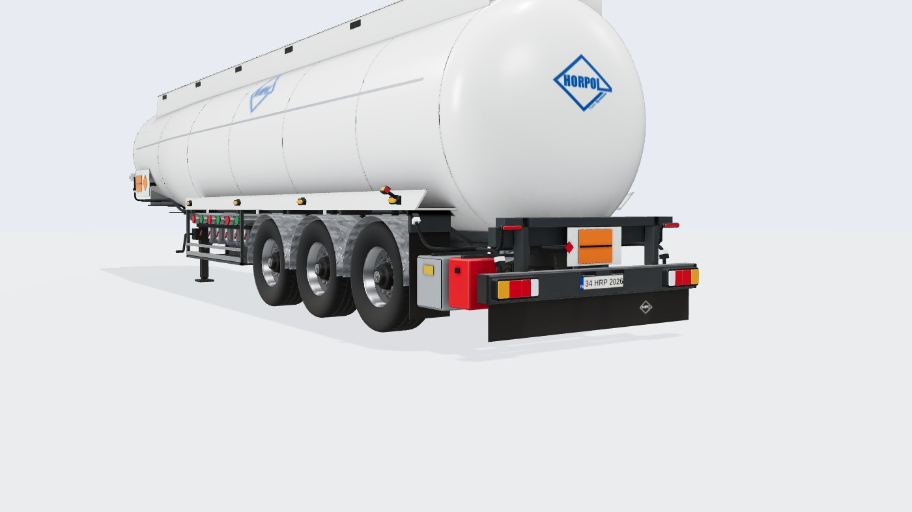
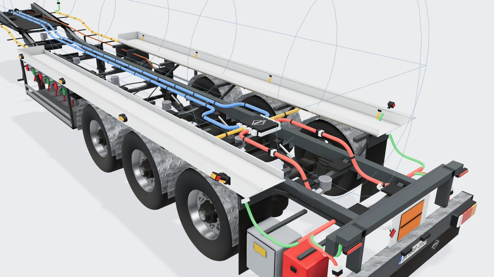
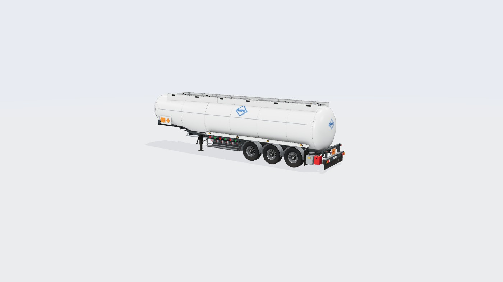
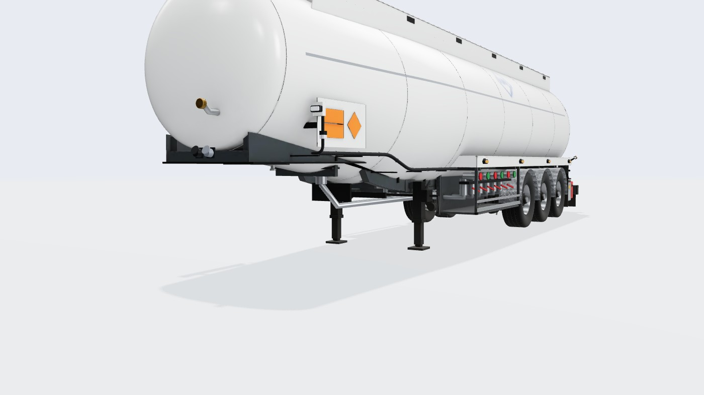
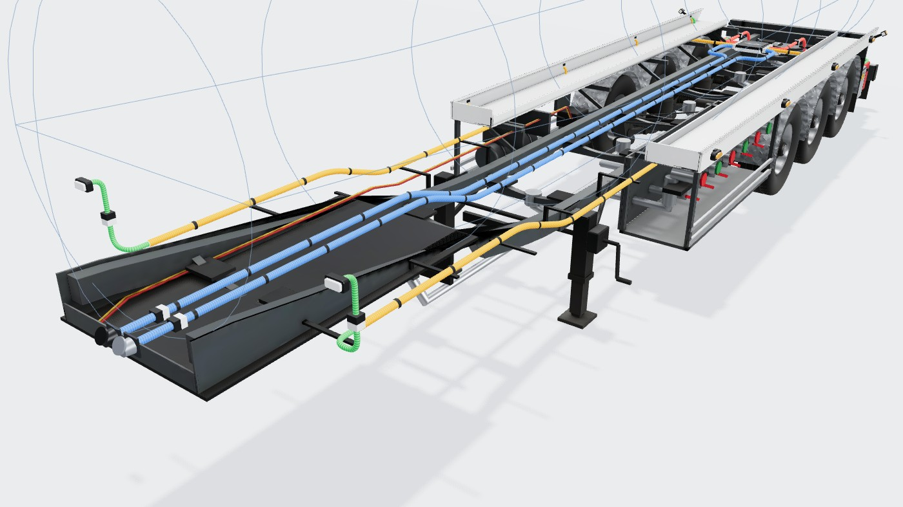

# Tanker Dorse (alüminyum akaryakıt tankeri, 6 bölmeli, 3 akslı)

Konfigüratördeki **tanker** tipinin 3D modeli: referans, ölçüler, kararlar, üretim hattı ve ölçümler.
Model Blender betiğiyle üretilir; sayıların tek kaynağı [`tools/blender/tanker.py`](../../tools/blender/tanker.py).
Bu belge betikteki değerlerin özeti ve gerekçesidir; betik ile çelişirse betik geçerlidir.
Ortak hat ve yöntem standart dorseyle aynıdır: [Standart Dorse](../Standart%20Dorse/README.md).

Durum: 2026-10-18'de kodlandı. Önceki kodla çizilen tanker (`engine/tanker.ts`) kaldırıldı.




## 1. Referans

| Kaynak | Ne alındı |
|---|---|
| [Kässbohrer K.STB E 45 / 6-14/24 ürün sayfası](https://kaessbohrer.com/en/products/tanker-599-c/dangerous-goods-622-c/kstb-e-45-6-14-24) | Teknik tablo, yapı tanımı |
| [Ürün broşürü (PDF)](https://www.kaessbohrer.com/uploads/static/media/product/999213/attachments/auto_pdf/brochure_999213_en.pdf) | Teknik tablo, **ölçekli yan/arka görünüş çizimi** (SVG), yüksek çözünürlüklü arka 3/4 fotoğraf |
| [Tanker serisi kataloğu (PDF)](https://kaessbohrer.com/uploads/2025/2/tank-trailers-series-en-v5-2025-02-13-151042.pdf) | Seri tablosu (K.STB E 39: alüminyum tank, boy 11.420, aks aralığı 1.310) |

Kässbohrer görselleri telifli olduğu için repoya kopyalanmadı. Üretici kırmızısı ve logosu kullanılmaz; yalnız Horpol logosu.

## 2. Teknik tablo (broşür)

| Ölçü | Değer |
|---|---|
| Eyer yüksekliği H5 | 1.250 mm |
| Tank çapı (D) | 2.350 mm |
| Dingil mesafesi (Wb) | 7.750 mm |
| Yükseklik (boş) | 3.330 mm |
| Hacim | 45 m³ brüt, 42 m³ net; 6 × 7.000 l |
| Şasi | İki ekstrüzyon alüminyum kutu profil + alüminyum çapraz bağlantılar |
| Akslar | BPW havalı süspansiyon, kampanalı fren, 3 × 9 t |
| Lastik | 385/65 R22,5 |
| Hortum taşıyıcı | Havuz tipi |
| Dolum / boşaltma | Üstten ve alttan |

## 3. Çizimden ve fotoğraftan ölçülenler

Çizim (SVG, 2400 px'e işlendi) piksel ölçümüyle okundu. Ölçek **133,4 px/m** (dingil mesafesi 7,75 m; arka görünüşte genişlik
2,55 m ile tutarlı).

| Ne | Değer | Not |
|---|---|---|
| Toplam boy | ~12,41 m | Ön havalandırma rakoru dahil (tablo bu model için boy vermiyor) |
| King pin | arka uca 10,88 m | |
| İniş ayağı | king pinin 2,54 m arkasında | Çizimdeki DLRh |
| Akslar | −4,44 / −3,13 / −1,82 m | Aralık 1,31 m |
| Tank üstü | 3,20 m | |
| Devrilme korkuluğu | 3,07–3,33 m | Yan levhalar ±0,68 m, eğik ön uç |
| Tank kesiti (arka) | Ø2,35, merkez 2,025 m, alt 0,85 m | Arka görünüş |
| Tank önü | alt ~1,36 m (Ø~1,84) | Ön kapak ve kesit; **üst çizgi yatay, tank önde daralan konik** |
| Hortum rafı | −7,47 … −0,81 m, 1,18–1,36 m | Fotoğraf: beyaz raf, eğik arka uç |
| API dolum dolabı | −7,47 … −5,20 m, 0,46–1,27 m | Ön aksın önünde, 6 rakor |
| Arka tampon | 0,45–0,67 m, paça 0,13 m'ye kadar | Arka görünüş |

## 4. Doğrulanmadı / varsayım

- **Konikliğin bittiği yer** (−8,2 m): ön Ø~1,84 ile arka Ø2,35 arasında; seçilen değerle hacim ~47 m³ (brüt 45).
- Ana kirişler tankın altını izler (z ±0,50 m): yan görünüşte king pinin arkasındaki eğik çizgiyle tutarlı; kesit tahmini.
- Dip vanaları her bölmenin arka ucunda, borular kirişlerin arasında dolaba gider (UK alttan dolum düzeni); dolap içi düzen
  fotoğraftan yaklaşık.
- Kapakların yeri eşit hacimli bölmelerin ortası (çizimdeki açık kapaklarla ±0,5 m uyumlu).
- Model tek boyda (12,41 m). Set uzunluğundan bağımsız.

## 5. Koordinatlar ve ana ölçüler (betikteki sabitler)

three.js düzeni: **x boyuna** (arka uç 0, ön −12,41), **y yukarı**, **z yanal**.

| Sabit | Değer | Anlam |
|---|---|---|
| `TOP` | 3,20 | Tank üstü |
| `XT0` / `XT1` / `XT2` | −11,87 / −8,20 / −0,76 | Ön kapak tabanı / konikliğin sonu / arka kapak tabanı |
| `f_r` | 0,92 → 1,175 | Tank yarıçapı (x'e göre) |
| `RAIL_TOP` / `RAIL_Z` | 3,33 / 0,68 | Devrilme korkuluğu |
| `BZ` | 0,50 | Ana kiriş ekseni |
| `TR_*` | −7,47…−0,81, 1,18–1,36 | Hortum rafı |
| `HY` | 1,16 | Tesisat (hortum rafının altında) |

## 6. Model yapısı

**Şasi (`tanker-chassis.glb`, tesisat görünümünde görünür):** king pin plakası ve konsol, tankın altını izleyen iki
alüminyum kutu kiriş (önde king pin plakasına iner), tankın altına oturan beşikler (lastik takozlu), tesisat kolları,
iniş ayakları (ortası boru geçişine açık), 3 aks BPW havalı süspansiyon ve kampanalı fren, havuz tipi hortum rafları,
damla desenli alüminyum çamurluklar, paçalar, API dolum dolabı (6 rakor, kırmızı/yeşil kapaklar, dip vana kolları,
koruma rayları), dip vanalarından dolaba 6 alt boru, −z yanında hava tankları, EBS ve koruma rayları, hava hatları ve
fren hortumları, arka çerçeve (travers, dikmeler, üst kuşak, ADR levhası), tampon (damla sac üst), paça levhası (beyaz logo),
dökülme kiti (gri) ve yangın tüpü (kırmızı) kutuları.

**Tank ve üst yapı (`tanker-body.glb`):** konik tank kabuğu ve bombeli kapaklar, bölme dikişleri, devrilme korkuluğu (yan
levhalar, kaburgalar), 6 kapak (havalandırma ve ölçüm kapakları), yürüme şeritleri, bölme numara levhaları, ön yan ADR
panoları ve ön lamba pabuçları, ön havalandırma rakoru, gri şerit, yanlarda ve arka kapakta logo.

## 7. Renk düzeni ve dokular

| Parça | Renk / malzeme |
|---|---|
| Tank, korkuluk | Parlak beyaz (vernikli), ince gri şerit |
| Şasi, arka çerçeve | Antrasit RAL 7016 |
| Hortum rafı | Beyaz |
| Çamurluklar, tampon üstü | Damla desenli alüminyum (tekrarlanan doku) |
| Jantlar | Cilalı alüminyum |
| Vurgular | Turuncu ADR levhaları, kırmızı yangın tüpü kutusu, kırmızı/yeşil rakor kapakları |

Şasi, tekerlek, tank ve üst yapı AO + renk/ORM pişirmeli (`bl_common.bake_surface`). Tank atlası 2048².

## 8. Bağlantı noktaları

[`tanker-anchors.json`](../../src/configurator/engine/tanker-anchors.json):

| Ne | Yer |
|---|---|
| Stop lambaları | Tampon, x = 0; y 0,56; z ±0,98 ve ±0,60 |
| Plaka | y 0,56, tampon ortası |
| Yan markerlar | Hortum rafının dış dudağı, y 1,27 |
| Ön pozisyon | Ön ADR panolarının ön ucu (y 1,80, z ±1,02) |
| Gabari | Hortum rafının ön ve arka ucu |
| Ek lambalar | Arka çerçevenin üst kuşağı, y 1,04 |
| Soketler | Konsolun ön yüzü, y 1,36 |
| Tesisat | Konsolda y 1,36, sonra hortum rafının altında y 1,16 (yan ana hat z ±0,86), arkada y 0,85 |

Bilinen sınırlama: orta hatlar (soketten modüle) tankın altından geçer; tesisat görünümünde tank gizli olduğu için
kirişlerin ~0,2 m üstünde görünür.

## 9. Üretim hattı

```bash
blender -b -P tools/blender/tanker.py          # tam kalite ~10 dk; --fast ~3 dk; --anchors yalnız JSON
npm run models:pack -- tanker
```

## 10. Ölçümler

| Ölçüm | Değer |
|---|---|
| Model indirme | 2,46 MB (gzip 1,84 MB) |
| Üçgen | şasi 57,6 bin, tekerlek 17,7 bin (× 6), tank 20,4 bin, üst yapı 14,2 bin, çamurluklar 5,1 bin |

## 11. Görseller

| | |
|---|---|
| Genel  | Arka 3/4  |
| Ön 3/4  | Tesisat, ön  |
| Tesisat, arka  | |

## 12. Lamba montaj haritası (R48)

Kaynak: `tanker.py` → `mounts_dict()` → `tanker-anchors.json` içindeki `mounts`. Kontrol: `node tools/check-lighting.mjs`.
Tank kabuğu lamba taşımaz.

| Montaj | Yer (x, y, z) | Parça | Gerekçe |
|---|---|---|---|
| Arka lambalar | yüz x 0; y 0,56; z 1,20 → 0,30 | Tampon | Dış kenara 0,075 m |
| Plaka + lambası | plaka y 0,56; lambalar y 0,645, z ±0,17 | Tampon | |
| Yan marker | x −9,73 … −0,96; y 1,27 (arka uçta 1,30); z 1,273; yan başına en çok 6 | Hortum rafı dudağı; −7,47'nin önünde kirişten L braket (`side.brackets`) | Eski ilk marker önden 5,2 m gerideydi (≤ 3). İniş ayağı ve tesisat kolları `side.avoid`. Tekerlek ve dolap nedeniyle 0,9 m altına inilemez (R48 6.18 ≤ 1,5). En az 4 |
| Ön pozisyon | x −11,575; y 1,40; z 1,15 | Kirişten dışa ön braket (x −11,55, z 0,55 → 1,19) | Eski yer ADR panosunda z 1,02 idi (dış kenara ~0,2 m). Tank burada r ≈ 0,94: braketin üstü boş |
| Lastik kol ön | x −11,52; y 1,40; duvar z 1,19 | Aynı ön braket | |
| Lastik kol arka | x −0,14; y 1,08; duvar z 1,0 | Arka çerçeve üst kuşağının uç yüzü | Dış kenara 0,275 m; arkada en yüksek sabit uç. Alternatif: tampon ucu y 0,56 (`armRearAlt`) |
| Çalışma (2) | x −0,08; y 1,18; z ±0,60; yön (1, −0,35, 0) | Üst kuşağın üstü (braket) | Arka kapak bombesi (x ≈ −0,45) önde kalır |
| Tepe (2) | x −0,85; y 3,33; z ±0,66 | Devrilme korkuluğu üst başlığının arka ucu + adaptör | En yüksek sabit yer, 360° |
| Tesisat | önde king pin plakası üstü 1,30, plaka bitince kiriş alt başlığı hizası 0,80; yan hat z 0,42; modül x −0,80; arka dağıtım x −0,25 | Kutu kirişin iç yüzü | Modül tankın en alt noktasının (0,85) altında. Önde orta ana hat tank kabuğunun altından geçer (bilinen sınırlama) |
